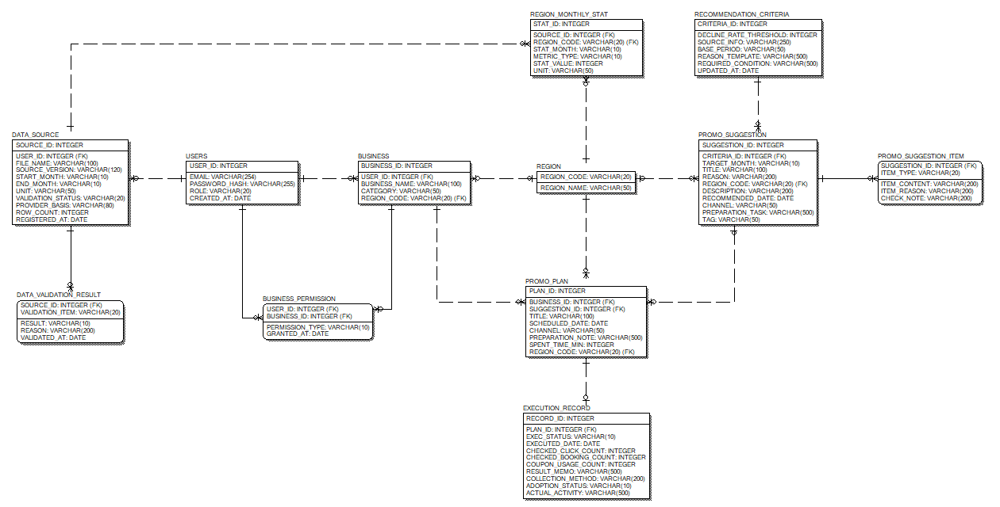

# ERD 수정 가이드

- 작성일: 2026-10-10
- 고친 날: 2026-10-11 (2차 수정 반영)
- 프로젝트: 제주 비수기 상권 마케팅 캘린더
- 기준 자료: 「[8주차] 정보시스템 프로젝트 설계 Data Modeling」 강의자료 56쪽 (아래에서는 'PDF'로 줄여 씀)
- 대상 파일: [Red_ERD.erwin](Red_ERD.erwin) (ERwin Data Modeler r7.3)
- 이미 고친 내용: [ERD 수정 내역](ERD_수정_내역.md)
- 화면 시안과 다른 곳: [ERD 프로토타입 대조 가이드](ERD_프로토타입_대조_가이드.md) (P1부터 P27까지 2차 수정에서 모두 반영함)

자동으로 고치지 못한 작업과 팀이 확인해야 하는 부분을 PDF의 작성 방법에 맞춰 정리함 2차 수정으로 Q1부터 Q7까지는 결정이 끝났고, 결과는 3장에 적음

## 1. 해야 할 일 순서

1. ERwin r7.3으로 [Red_ERD.erwin](Red_ERD.erwin)을 엶
2. 엔터티 배치를 확인함 (2026-10-11 정리 완료) → [2.1](#21-엔터티-배치-맞추기)
3. 물리 화면에 자료형이 보이게 함 → [2.2](#22-물리-화면에-자료형-표시)
4. 3장의 결정 결과를 팀이 확인하고, 화면 시안의 입력 칸을 ERD에 맞게 고침 → [3장](#3-팀이-정해야-하는-부분)
5. SQL 스키마를 만들고 테이블 명세서와 코드 설계서를 작성함 → [2.3](#23-sql-스키마와-테이블-명세서)
6. 4장 체크리스트로 마지막 확인을 함 → [4장](#4-완료-확인-체크리스트)

## 2. ERwin에서 직접 해야 하는 작업

### 2.1 엔터티 배치 맞추기

**2026-10-11 완료** 엔터티 12개의 위치와 관계선 15개의 경로를 다시 정해 Red_ERD.erwin에 저장함 ERwin r7.3으로 열어 논리 화면과 물리 이름·자료형 폭에서 상자가 겹치지 않고, 관계선이 상자를 지나거나 서로 교차하지 않는 것을 확인함

| 줄 | 1열 | 2열 | 3열 | 4열 | 5열 | 6열 |
| --- | --- | --- | --- | --- | --- | --- |
| 윗줄 | | | | 지역 월별 통계 | 추천기준 | |
| 가운데 줄 | 자료 등록 현황 | 사용자 | 사업체 | 지역 | 홍보 제안 | 제안 항목 |
| 아랫줄 | 자료 검증 결과 | 사업체 권한 (2열과 3열 사이) | | 3개월 홍보 일정 | | |
| 맨 아래 | | | | 실행 결과 기록 | | |

- 관계가 있는 엔터티끼리 이웃하게 두고, 관계선은 모두 직선이거나 한 번만 꺾이게 함
- 물리 화면에서 영문 이름과 자료형 때문에 상자가 넓어져도 겹치지 않게 열 사이를 넓게 잡음
- 전체가 넓으므로 ERwin에서 Zoom Out(Ctrl + -)으로 한 화면에 모아 봄

ERwin에서 연 화면

두 번째 그림은 물리 화면의 상자 폭을 확인하려고 이름 자리에 '물리 이름: 자료형'을 넣은 확인용 복사본을 연 것임 실제 Red_ERD.erwin의 논리 이름은 바뀌지 않았음

배치를 고칠 때 주의할 점

- **Layout Entire Diagram은 누르지 않음** 누르면 위의 배치가 모두 바뀜
- 상자를 옮겨 선이 꼬이면 **Format → Stored Display Settings... → Layout 탭 → Redraw All Relationship Lines**를 누름
- 고친 뒤 File → Save로 저장함

### 2.2 물리 화면에 자료형 표시

PDF 51쪽, 52쪽, 54쪽의 물리 모델 예시는 컬럼 이름 옆에 자료형을 보여줌 이 표시 설정도 자동으로 바꿀 수 없었음

1. 도구 모음의 Logical/Physical 선택 상자에서 **Physical**을 고름 (PDF 44쪽의 Physical Model 전환과 같은 동작)
2. **Format → Display Level → Column**을 고름
3. **Format → Table Display → Column Datatype**에 체크함 PDF 54쪽처럼 NULL 여부까지 보이려면 **Null Option**도 체크함
4. 다시 **Logical**로 바꾸고 **Format → Display Level → Attribute**인지 확인함
5. 저장함

메뉴가 보이지 않으면 다이어그램의 빈 곳을 오른쪽 클릭해 같은 이름의 메뉴를 찾음

### 2.3 SQL 스키마와 테이블 명세서

PDF 47쪽, 53쪽, 55쪽의 순서를 따름

1. 물리 화면에서 **Tools → Forward Engineer → Schema Generation**을 엶
2. Preview로 CREATE TABLE 문장을 확인하고 .sql 파일로 저장함 저장소의 이 폴더에 두면 ERD와 함께 찾기 쉬움
3. Oracle은 VARCHAR 길이를 기본적으로 바이트로 세서 한글이 적게 들어감 ERD의 길이는 화면과 같은 글자 수 기준이므로, SQL을 실행하기 전에 `ALTER SESSION SET NLS_LENGTH_SEMANTICS = CHAR;`를 먼저 실행해 글자 수로 세게 함 (프로토타입 대조 가이드 P8)
4. 수업에서 제공한 테이블 명세서 서식으로 작성함 ERD의 물리 이름을 '컬럼명', 논리 이름을 '설명'에 쓰고 KEY 구분, Null, Unique, DataType, 길이는 Red_ERD.erwin의 설정과 같게 씀
5. FK 목록에는 관계 이름(BusinessUser 등), 관련 테이블, 컬럼명을 씀
6. 3개월 홍보 일정의 참고사항에 '같은 사업체에 같은 홍보 제안을 두 번 담지 못하게 하는 확인은 프로그램에서 함'을 적음 (프로토타입 대조 가이드 P17)
7. 코드 설계서에는 [수정 내역 1.4](ERD_수정_내역.md#14-코드값-코드-설계서-초안)의 코드값을 옮겨 적음 (PDF 55쪽)

## 3. 팀이 정해야 하는 부분

### 3.1 Q1부터 Q7까지의 결정 결과

PDF 13쪽의 논리적 모델링 과정(상세 속성 추출 → 정규화 → 데이터 표준화)과 정규화 기준(PDF 29쪽부터 34쪽까지)으로 남겼던 질문임 팀 수정본의 선택과 화면 시안의 동작을 바탕으로 2차 수정에서 아래처럼 정함

| 번호 | 질문 | 결정 | 근거 | 남은 일 |
| --- | --- | --- | --- | --- |
| Q1 | 출처 및 기준 기간을 나눌까 | 출처 SOURCE_INFO, 기준 기간 BASE_PERIOD로 나눔 (팀 결정) | 1정규형 원자값 (32쪽) | 화면 시안의 '분석 결과·출처·기준기간·단위' 입력 칸 하나를 나눠야 함 |
| Q2 | 결과 및 수집 방법을 나눌까 | 결과 내용 RESULT_MEMO, 수집 방법 COLLECTION_METHOD로 나눔 (팀 결정) | 1정규형 원자값 (32쪽) | 화면 시안의 '결과와 수집 방법' 입력 칸을 나눠야 함 |
| Q3 | 관광지·상품 후보를 따로 둘까 | '제안 항목' 엔터티로 옮기고 항목마다 내용과 이유를 저장함 | 화면이 항목마다 이유를 보여줌, 1차 정규화 (31쪽) | 없음 |
| Q4 | 소요 시간은 어디에 둘까 | 3개월 홍보 일정으로 옮김 (팀 결정) | 화면의 '계획 소요 시간', 3정규형 (34쪽) | 화면설계서에서 이 값을 입력하는 위치 설명을 확인함 |
| Q5 | 추천 채택 여부를 지울까 | 지우지 않고 ADOPTION_STATUS로 둠 | 화면이 직접 고르는 값이라 일정의 홍보 제안 ID와 뜻이 다름 | 없음 |
| Q6 | 길이, 월 값, 여부 값 | 길이는 화면 제한을 따름 월 값은 모두 VARCHAR(10)(YYYY-MM) 여부 값은 VARCHAR(10) 상태 코드 | 51쪽 자료형 규칙, 13쪽 데이터 표준화 | 3.2의 임시 길이를 확인함 |
| Q7 | 테이블 이름에 TBL_을 붙일까 | 붙이지 않고 그대로 둠 | 51쪽, 52쪽, 53쪽, 55쪽 예시는 TBL_을 쓰지만 54쪽 예시와 규칙 문장에는 없음 | 수업에서 요구하면 Table Properties에서 이름을 바꾸고 테이블 명세서도 같이 고침 |

### 3.2 팀이 확인할 값

화면 시안에 제한이 없어 임시로 정한 값임 실제 자료를 보고 바꾸면 Column Properties에서 Physical Data Type을 고침 (46쪽)

| 컬럼 | 임시 값 | 확인할 내용 |
| --- | --- | --- |
| RECOMMENDATION_CRITERIA.BASE_PERIOD | VARCHAR(50) | 기준 기간을 어떤 글자로 적는지 |
| EXECUTION_RECORD.COLLECTION_METHOD | VARCHAR(200) | 수집 방법 입력 칸의 최대 길이 |
| PROMO_SUGGESTION의 DESCRIPTION, REASON, TITLE | VARCHAR(200), VARCHAR(200), VARCHAR(100) | 제안 문장의 최대 길이 |
| PROMO_SUGGESTION_ITEM의 ITEM_CONTENT, ITEM_REASON, CHECK_NOTE | 모두 VARCHAR(200) | 항목 문장의 최대 길이 |
| 코드값 이름 | [수정 내역 1.4](ERD_수정_내역.md#14-코드값-코드-설계서-초안) | 코드 이름을 바꾸면 VARCHAR 길이도 함께 확인 |

ERwin에서 고치는 방법

- 속성 추가·삭제·이동: 논리 화면에서 엔터티 상자 안의 속성을 고침 (39쪽)
- 엔터티 추가와 관계 연결: 도구 모음의 엔터티 도구와 1:N 식별·비식별 관계 도구를 사용함 (37쪽, 40쪽) 관계 이름과 Null Option은 관계선 오른쪽 클릭 → Properties에서 [수정 내역 4장](ERD_수정_내역.md#4-현재-관계-2차-수정-후)과 같은 방식으로 정함 (42쪽)
- 자료형: 물리 화면에서 테이블 오른쪽 클릭 → Column Properties (46쪽)
- 속성을 지우고 다시 만들면 물리 이름이 한글, 자료형이 CHAR(18)로 돌아가므로 Column Properties에서 다시 정함 (2차 수정의 E2 오류가 이렇게 생겼음)
- 바꾼 내용은 [ERD 수정 내역](ERD_수정_내역.md)에 날짜와 함께 적음

## 4. 완료 확인 체크리스트

2026-10-11 기준으로 파일과 ERwin 화면에서 확인한 항목은 체크함

- [x] Model Properties의 Notation이 논리·물리 모두 IE임 (38쪽)
- [x] 한 파일에서 Logical과 Physical 화면을 바꿔 볼 수 있음 (38쪽, 44쪽)
- [x] 관계 15개에 R/ 번호가 아닌 이름이 있음 (42쪽)
- [x] 물리 이름이 모두 영문 대문자이고 CHAR(18)로 남은 컬럼이 없음 (51쪽)
- [x] Q1부터 Q7까지 정한 내용을 기록함 (3.1)
- [x] 비식별 관계는 점선, 식별 관계 4개(ResultSource, ItemSuggestion, PermissionUser, PermissionBusiness)는 실선으로 보임 부모 쪽 동그라미는 Nulls Allowed인 PlanSuggestion, BusinessRegion, SuggestionRegion에만 있음 (27쪽, 28쪽, 40쪽, 43쪽)
- [x] 엔터티 12개와 관계선 15개가 겹치지 않음 (2.1)
- [ ] 물리 화면에 자료형이 함께 보임 (51쪽, 52쪽)
- [ ] 화면 시안의 입력 칸을 Q1, Q2 결정에 맞게 나눔
- [ ] Schema Generation으로 만든 SQL, 테이블 명세서, 코드 설계서가 ERD와 같음 (47쪽, 53쪽, 55쪽)
- [ ] 팀원 모두 같은 ERwin 버전(r7.3)을 사용함 ERwin 15.2에서는 원본 파일이 열리지 않았음
