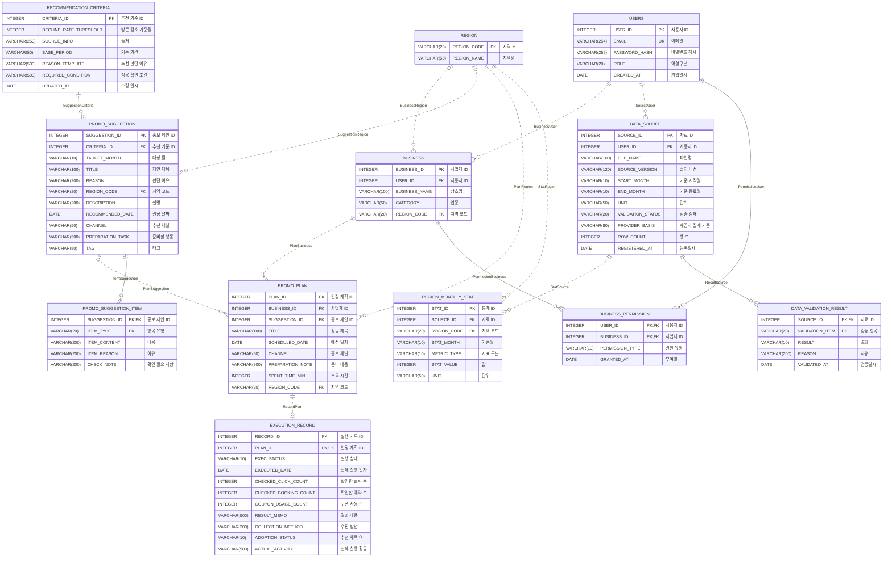

# ERD 수정 내역

- 1차 수정: 2026-10-10 (강의자료 형식 맞추기)
- 2차 수정: 2026-10-11 (팀 수정본의 오류 수정과 화면 시안 기준 반영)
- 프로젝트: 제주 비수기 상권 마케팅 캘린더
- 기준 자료: 「[8주차] 정보시스템 프로젝트 설계 Data Modeling」 강의자료 56쪽 (아래에서는 'PDF'로 줄여 씀)
- 화면 기준: 화면 시안 [app.js](../../02_제품/화면시안/app.js)와 [ERD 프로토타입 대조 가이드](ERD_프로토타입_대조_가이드.md)
- 원본: 팀이 처음 공유한 [Logical ERD.erwin](<원본/Logical ERD.erwin>), [Physical ERD.erwin](<원본/Physical ERD.erwin>), 1차 수정본을 팀이 고친 [Red_ERD_팀수정_20261011.erwin](원본/Red_ERD_팀수정_20261011.erwin) (모두 ERwin Data Modeler r7.3)
- 결과: [Red_ERD.erwin](Red_ERD.erwin) (Logical/Physical 모델 1개, 엔터티 12개)
- 남은 작업: [ERD 수정 가이드](ERD_수정_가이드.md)

## 1. 2차 수정 (2026-10-11)

팀이 1차 수정본을 고쳐 보낸 파일을 그대로 열어 고침 팀이 맞춘 엔터티 배치를 살리기 위해 새 파일을 만들지 않았음

### 1.1 팀 수정본에서 그대로 살린 것

| 항목 | 내용 | 근거 |
| --- | --- | --- |
| 엔터티 배치 | 원본과 같은 3줄 배치 | [가이드 2.1](ERD_수정_가이드.md#21-엔터티-배치-맞추기) |
| 소요 시간 이동 | 실행 결과 기록에서 3개월 홍보 일정으로 옮김 | 화면의 입력 칸 이름이 '계획 소요 시간'임 ([361줄](../../02_제품/화면시안/app.js#L361)), 가이드 Q4 |
| 출처와 기준 기간 분리 | 추천기준의 '출처 및 기준 기간'을 두 속성으로 나눔 | 1정규형 원자값 (PDF 32쪽), 가이드 Q1 |
| 결과 내용과 수집 방법 분리 | 실행 결과 기록의 '결과 및 수집 방법'을 두 속성으로 나눔 | 1정규형 원자값 (PDF 32쪽), 가이드 Q2 |
| 기준 시작월·종료월 형식 | START_MONTH, END_MONTH VARCHAR(10) | 화면은 연도와 월(YYYY-MM)만 입력함 ([238줄](../../02_제품/화면시안/app.js#L238)), 가이드 Q6 |
| 클릭·예약·쿠폰 컬럼 이름 | CHECKED_CLICK_COUNT, CHECKED_BOOKING_COUNT, COUPON_USAGE_COUNT | 영문 대문자 규칙(PDF 51쪽)에 맞음 |

출처와 기준 기간, 결과 내용과 수집 방법은 화면 시안에서 각각 입력 칸 하나로 받음 ERD를 나눈 만큼 화면 입력 칸도 나눠야 함 → [가이드 3장](ERD_수정_가이드.md#3-팀이-정해야-하는-부분)

### 1.2 고친 오류

| 번호 | 팀 수정본 | 수정 | 근거 |
| --- | --- | --- | --- |
| E1 | 사업체의 논리 이름 '지역 코드'가 BUSINESS_NAME에, '상호명'이 REGION_CODE에 연결됨 | '상호명'을 BUSINESS_NAME에 다시 연결함 지역 코드는 새 지역 엔터티의 외래키로 다시 만듦 (P27) | 논리 이름과 물리 이름은 같은 값을 뜻해야 함 |
| E2 | 추천기준의 속성 6개와 '수집 방법'의 물리 이름이 한글(방문_감소_기준율 등)이고 자료형이 CHAR(18) | 영문 대문자 이름과 INTEGER, VARCHAR(), DATE로 고침 | PDF 51쪽 |
| E3 | 옮긴 소요 시간이 '소요_시간 INT' | SPENT_TIME_MIN INTEGER | PDF 51쪽 숫자형 INTEGER |
| E4 | 추천 기준 ID만 VARCHAR(20) (다른 ID는 모두 INTEGER) | INTEGER로 되돌림 홍보 제안의 외래키도 함께 바뀜 | PDF 51쪽 숫자형 INTEGER 바꾼 이유가 기록되지 않았음 |
| E5 | '추천 채택 여부' 삭제 | 추천 채택 여부 ADOPTION_STATUS로 다시 만듦 (P15) | 화면이 미확인, 채택, 미채택을 사용자에게 직접 받음 ([361줄](../../02_제품/화면시안/app.js#L361)) 일정의 홍보 제안 ID와 다른 값임 (프로토타입 대조 가이드 Q5) |
| E6 | '주변 관광지', '추천 상품 후보' 삭제 ('홍보 대상'은 남음) | 세 값을 '제안 항목' 엔터티에 항목별로 저장함 (P25) | 화면이 홍보 시기, 홍보 대상, 상품 후보, 주변 관광지마다 내용과 이유를 따로 보여줌 ([194줄](../../02_제품/화면시안/app.js#L194)) |

### 1.3 프로토타입 대조 가이드 반영

P1부터 P27까지 모두 반영함 가이드에서 팀 결정으로 남긴 항목은 화면 시안의 동작을 근거로 정했고, 정한 내용과 이유를 '결정' 칸에 적음

| 번호 | 반영 내용 | 결정과 근거 |
| --- | --- | --- |
| P1 | USERS.EMAIL VARCHAR(254) | |
| P2 | 비밀번호를 '비밀번호 해시' PASSWORD_HASH VARCHAR(255)로 바꿈 | 결정: 비밀번호는 해시 값으로 저장함 해시 방식은 개발 단계에서 정하고, 255자는 그 값을 담기 위한 길이임 |
| P3 | DATA_SOURCE.SOURCE_VERSION VARCHAR(120) | |
| P4 | 출처 SOURCE_INFO VARCHAR(250) | 팀이 나눈 두 속성 중 출처에 화면 제한 250자를 적용함 기준 기간 BASE_PERIOD는 VARCHAR(50) |
| P5 | REASON_TEMPLATE, REQUIRED_CONDITION VARCHAR(500) | |
| P6 | PROMO_PLAN.PREPARATION_NOTE VARCHAR(500) | |
| P7 | 결과 내용 RESULT_MEMO VARCHAR(500) | 나눠진 수집 방법 COLLECTION_METHOD는 VARCHAR(200) |
| P8 | DBMS는 Oracle 그대로 둠 길이 숫자는 화면과 같은 글자 수 기준 | 결정: PDF 38쪽과 모델 설정이 Oracle임 Oracle에서 길이를 글자 수로 세도록 SQL 실행 전에 설정함 → [가이드 2.3](ERD_수정_가이드.md#23-sql-스키마와-테이블-명세서) |
| P9 | PROMO_PLAN의 TITLE, SCHEDULED_DATE, CHANNEL NOT NULL | |
| P10, P14 | '실행 여부'를 '실행 상태' EXEC_STATUS VARCHAR(10) NOT NULL로 바꿈 | 코드값은 1.4 |
| P11 | 추천기준의 기준율, 출처, 기준 기간, 판단 이유, 적용 조건 NOT NULL | 팀이 출처와 기준 기간을 나눠서 다섯 컬럼이 됨 |
| P12 | DATA_SOURCE의 FILE_NAME, SOURCE_VERSION, START_MONTH, END_MONTH, UNIT NOT NULL | |
| P13 | USERS의 EMAIL, PASSWORD_HASH, ROLE NOT NULL, EMAIL UNIQUE | UNIQUE는 Alternate Key(AK1)로 만듦 |
| P15 | 추천 채택 여부 ADOPTION_STATUS VARCHAR(10) NOT NULL | 결정: 방법 2(상태 코드) 실행 상태와 같은 방식이고, 문자형은 VARCHAR()라는 PDF 51쪽 규칙과 맞음 화면은 항상 하나를 고르므로(처음 값은 미확인) NOT NULL |
| P16 | RecordPlan의 Cardinality를 Zero or One으로, EXECUTION_RECORD.PLAN_ID UNIQUE | |
| P17 | ERD는 바꾸지 않음 | 결정: Oracle에서는 제안 ID가 비어 있는 직접 추가 계획까지 막히므로 UNIQUE를 쓰지 않음 같은 제안을 두 번 담지 못하게 하는 확인은 프로그램에서 한다고 테이블 명세서에 적음 → [가이드 2.3](ERD_수정_가이드.md#23-sql-스키마와-테이블-명세서) |
| P18 | RecordPlan의 부모 삭제(Parent Delete)를 Cascade로 바꿈 | |
| P19 | EXECUTION_RECORD에 실제 실행 활동 ACTUAL_ACTIVITY VARCHAR(500) | |
| P20 | DATA_SOURCE에 PROVIDER_BASIS VARCHAR(80), ROW_COUNT INTEGER, REGISTERED_AT DATE (모두 NOT NULL) | |
| P21 | PROMO_SUGGESTION에 DESCRIPTION, RECOMMENDED_DATE, CHANNEL, PREPARATION_TASK, TAG | |
| P22 | PROMO_PLAN에 지역 코드(FK) NOT NULL | 결정: 화면이 계획마다 그때 고른 분석 지역을 저장하고 ([485줄](../../02_제품/화면시안/app.js#L485)), 분석 지역은 바꿀 수 있어 사업체 지역과 다를 수 있음 |
| P23 | '자료 검증 결과' 엔터티 PK는 자료 ID(FK)와 검증 항목, DATA_SOURCE와 식별 관계 ResultSource | 가이드의 '바꾸기로 하면'대로 만듦 |
| P24 | '지역 월별 통계' 엔터티 DATA_SOURCE(StatSource), 지역(StatRegion)과 1:N 비식별 관계 | 값 STAT_VALUE는 INTEGER, NULL 허용 화면 예시 값이 정수이고 빈 값은 null임 ([86줄](../../02_제품/화면시안/app.js#L86)) |
| P25 | '제안 항목' 엔터티 PK는 홍보 제안 ID(FK)와 항목 유형, 홍보 제안과 식별 관계 ItemSuggestion 홍보 대상, 주변 관광지, 상품 후보는 이 엔터티로 옮김 | 가이드의 '바꾸기로 하면'대로 만듦 |
| P26 | '사업체 권한' 엔터티 PK는 사용자 ID(FK)와 사업체 ID(FK), 사용자·사업체와 식별 관계 (PDF 41쪽, 50쪽의 M:N 해소) | 사업체의 사용자 ID(소유자)는 그대로 둠 |
| P27 | '지역' 엔터티 (지역 코드 PK, 지역명) 사업체, 홍보 제안, 3개월 홍보 일정, 지역 월별 통계의 지역 코드를 외래키로 연결 | 사업체와 홍보 제안은 원래처럼 NULL 허용, 일정(P22)과 통계는 화면과 CSV에서 항상 있는 값이라 NOT NULL |

데이터 표준화(PDF 13쪽)에 따라 홍보 제안의 대상 월 TARGET_MONTH도 DATE에서 VARCHAR(10)으로 바꿔 다른 월 값과 같은 형식으로 맞춤

### 1.4 코드값 (코드 설계서 초안)

PDF 55쪽 서식의 코드 설계서에 옮겨 적을 값임 코드 이름은 초안이라 팀이 바꿀 수 있고, 바꾸면 VARCHAR 길이를 함께 확인함

| 컬럼 | 코드 | 뜻 | 근거 |
| --- | --- | --- | --- |
| USERS.ROLE | BUSINESS, SERVICE | 사업체 운영자, 서비스 운영자 | [289줄](../../02_제품/화면시안/app.js#L289) |
| EXECUTION_RECORD.EXEC_STATUS | DONE, NOT_DONE, CHECKING | 실행함, 미실행, 확인 중 | [361줄](../../02_제품/화면시안/app.js#L361), P14 |
| EXECUTION_RECORD.ADOPTION_STATUS | YES, NO, UNKNOWN | 채택, 미채택, 미확인 | [361줄](../../02_제품/화면시안/app.js#L361) |
| DATA_VALIDATION_RESULT.VALIDATION_ITEM | PERIOD, AGGREGATION, REGION_CODE, MISSING_VALUE, PROVIDER | 자료 기간, 집계 기준, 지역 코드, 누락값, 제공 기준 일관성 | [263줄](../../02_제품/화면시안/app.js#L263), UC08 |
| DATA_VALIDATION_RESULT.RESULT | PASS, FAIL | 통과, 실패 | P23 |
| REGION_MONTHLY_STAT.METRIC_TYPE | VISIT, SPEND | 방문, 소비 | [86줄](../../02_제품/화면시안/app.js#L86) |
| PROMO_SUGGESTION_ITEM.ITEM_TYPE | TIMING, AUDIENCE, PRODUCT, ATTRACTION | 홍보 시기, 홍보 대상, 상품 후보, 주변 관광지 | [194줄](../../02_제품/화면시안/app.js#L194) |
| BUSINESS_PERMISSION.PERMISSION_TYPE | OWNER, MANAGER | 소유, 관리 | P26 |
| REGION.REGION_CODE | 50110253, 50110256 | 애월읍, 구좌읍 | [265줄](../../02_제품/화면시안/app.js#L265) |
| DATA_SOURCE.UNIT, REGION_MONTHLY_STAT.UNIT | 만 명, 억 원 | 방문 단위, 소비 단위 | [238줄](../../02_제품/화면시안/app.js#L238) |

## 2. 1차 수정 (2026-10-10)

팀이 처음 공유한 논리·물리 파일 두 개를 PDF의 작성 방법에 맞춘 내용임 아래는 그때의 기록이며, 지금 모델은 3장과 4장을 봄

### 2.1 한눈에 보기

| 번호 | 항목 | 원본 | 수정 결과 | PDF 근거 |
| --- | --- | --- | --- | --- |
| 1 | 모델 종류 | 논리 전용(Logical) 파일과 물리 전용(Physical) 파일을 따로 작성 | **Logical/Physical 모델 1개**로 합침 논리 화면은 한글 이름, 물리 화면은 영문 이름 | 38쪽 모델 타입 Logical/Physical, 44쪽 같은 모델에서 Physical Model로 전환 |
| 2 | DBMS | Oracle 10 | Oracle 10 유지 | 38쪽 DBMS Oracle |
| 3 | 표기법 | IDEF1X (◇·● 기호) | **IE 표기법** (까마귀발 기호) | 38쪽 IE 표기법으로 변경, 26쪽부터 28쪽까지 IE 관계 표기 |
| 4 | 관계 이름 | R/1, R/2 같은 기본 이름 | BusinessUser처럼 자식·부모 순서의 영문 이름 | 42쪽 R/1 → BookPublisher 예시 |
| 5 | 관계 Null Option | 6개 모두 Nulls Allowed | 5개 **Nulls Not Allowed**, 1개는 Nulls Allowed 유지 | 42쪽 Null Option 변경 |
| 6 | 물리 컬럼 이름 | 소문자 (user_id) | **영문 대문자** (USER_ID) | 51쪽 개체 및 속성 명 영문 대문자로 변경 |
| 7 | 물리 자료형 | 50개 모두 CHAR(18) (ERwin 기본값) | 숫자 INTEGER, 문자 VARCHAR(), 날짜 DATE, 여부 값 CHAR(1) | 51쪽 숫자형 INTEGER·문자형 VARCHAR()·날짜형 DATE, 54쪽 예시의 CHAR(1) |
| 8 | 논리·물리 속성 연결 | 홍보 제안의 '주변 관광지'·'추천 상품 후보'와 물리 컬럼의 순서가 서로 어긋남 | 이름 뜻에 맞게 ATTRACTION_INFO, PRODUCT_CANDIDATE로 연결 | 1번과 같이 한 모델에서 논리·물리 이름을 함께 관리 |

1차 수정에서는 엔터티·속성·관계의 내용을 원본 그대로 두었음 관계선 위 동사구는 PDF 26쪽의 '초록색 텍스트에 해당하는 내용을 작성하지 않음'에 따라 쓰지 않았고, 이 원칙은 2차 수정에도 그대로 적용함

### 2.2 1차 관계 수정

관계 이름은 PDF 42쪽의 BookPublisher(자식 Book, 부모 Publisher)처럼 자식 다음에 부모를 붙임 2차 수정에서 새로 만든 관계도 같은 방식임

| Parent | Child | 기존 이름 | 수정 이름 | Null Option | 판단 근거 |
| --- | --- | --- | --- | --- | --- |
| 사용자 | 사업체 | R/1 | BusinessUser | Nulls Not Allowed | 사업체는 반드시 사용자 계정에 속함 |
| 사용자 | 자료 등록 현황 | R/2 | SourceUser | Nulls Not Allowed | CSV는 서비스 운영자가 등록함 (UC07) |
| 추천기준 | 홍보 제안 | R/4 | SuggestionCriteria | Nulls Not Allowed | 제안은 추천 기준과 근거를 바탕으로 판단 이유와 함께 보여줌 (UC02, UC09) |
| 사업체 | 3개월 홍보 일정 | R/5 | PlanBusiness | Nulls Not Allowed | 일정은 사업체별로 저장함 (F03) |
| 홍보 제안 | 3개월 홍보 일정 | R/7 | PlanSuggestion | **Nulls Allowed 유지** | [화면설계서](../../00_제출/Red_SCREEN.md)의 '월별 직접 추가'로 제안 없이도 일정을 저장할 수 있음 |
| 3개월 홍보 일정 | 실행 결과 기록 | R/8 | RecordPlan | Nulls Not Allowed | 실행 기록은 저장한 일정에 대해 남김 (UC04) 2차 수정에서 Zero or One과 Cascade를 더함 |

## 3. 현재 테이블과 컬럼 (2차 수정 후)

Red_ERD.erwin을 다시 읽어 만든 표임 키 칸의 FK는 관계로 이전된 외래키, UNIQUE는 Alternate Key임

**USERS (사용자)**

| 논리 이름 | 물리 이름 | 자료형 | NULL | 키 |
| --- | --- | --- | --- | --- |
| 사용자 ID | USER_ID | INTEGER | NOT NULL | PK |
| 이메일 | EMAIL | VARCHAR(254) | NOT NULL | UNIQUE |
| 비밀번호 해시 | PASSWORD_HASH | VARCHAR(255) | NOT NULL |  |
| 역할구분 | ROLE | VARCHAR(20) | NOT NULL |  |
| 가입일시 | CREATED_AT | DATE | NULL |  |

**BUSINESS (사업체)**

| 논리 이름 | 물리 이름 | 자료형 | NULL | 키 |
| --- | --- | --- | --- | --- |
| 사업체 ID | BUSINESS_ID | INTEGER | NOT NULL | PK |
| 사용자 ID | USER_ID | INTEGER | NOT NULL | FK |
| 상호명 | BUSINESS_NAME | VARCHAR(100) | NULL |  |
| 업종 | CATEGORY | VARCHAR(50) | NULL |  |
| 지역 코드 | REGION_CODE | VARCHAR(20) | NULL | FK |

**PROMO_PLAN (3개월 홍보 일정)**

| 논리 이름 | 물리 이름 | 자료형 | NULL | 키 |
| --- | --- | --- | --- | --- |
| 일정 계획 ID | PLAN_ID | INTEGER | NOT NULL | PK |
| 사업체 ID | BUSINESS_ID | INTEGER | NOT NULL | FK |
| 홍보 제안 ID | SUGGESTION_ID | INTEGER | NULL | FK |
| 활동 제목 | TITLE | VARCHAR(100) | NOT NULL |  |
| 예정 일자 | SCHEDULED_DATE | DATE | NOT NULL |  |
| 홍보 채널 | CHANNEL | VARCHAR(50) | NOT NULL |  |
| 준비 내용 | PREPARATION_NOTE | VARCHAR(500) | NULL |  |
| 소요 시간 | SPENT_TIME_MIN | INTEGER | NULL |  |
| 지역 코드 | REGION_CODE | VARCHAR(20) | NOT NULL | FK |

**RECOMMENDATION_CRITERIA (추천기준)**

| 논리 이름 | 물리 이름 | 자료형 | NULL | 키 |
| --- | --- | --- | --- | --- |
| 추천 기준 ID | CRITERIA_ID | INTEGER | NOT NULL | PK |
| 방문 감소 기준율 | DECLINE_RATE_THRESHOLD | INTEGER | NOT NULL |  |
| 출처 | SOURCE_INFO | VARCHAR(250) | NOT NULL |  |
| 기준 기간 | BASE_PERIOD | VARCHAR(50) | NOT NULL |  |
| 추천 판단 이유 | REASON_TEMPLATE | VARCHAR(500) | NOT NULL |  |
| 적용 확인 조건 | REQUIRED_CONDITION | VARCHAR(500) | NOT NULL |  |
| 수정 일시 | UPDATED_AT | DATE | NULL |  |

**PROMO_SUGGESTION (홍보 제안)**

| 논리 이름 | 물리 이름 | 자료형 | NULL | 키 |
| --- | --- | --- | --- | --- |
| 홍보 제안 ID | SUGGESTION_ID | INTEGER | NOT NULL | PK |
| 추천 기준 ID | CRITERIA_ID | INTEGER | NOT NULL | FK |
| 대상 월 | TARGET_MONTH | VARCHAR(10) | NULL |  |
| 제안 제목 | TITLE | VARCHAR(100) | NULL |  |
| 판단 이유 | REASON | VARCHAR(200) | NULL |  |
| 지역 코드 | REGION_CODE | VARCHAR(20) | NULL | FK |
| 설명 | DESCRIPTION | VARCHAR(200) | NULL |  |
| 권장 날짜 | RECOMMENDED_DATE | DATE | NULL |  |
| 추천 채널 | CHANNEL | VARCHAR(50) | NULL |  |
| 준비할 행동 | PREPARATION_TASK | VARCHAR(500) | NULL |  |
| 태그 | TAG | VARCHAR(50) | NULL |  |

**EXECUTION_RECORD (실행 결과 기록)**

| 논리 이름 | 물리 이름 | 자료형 | NULL | 키 |
| --- | --- | --- | --- | --- |
| 실행 기록 ID | RECORD_ID | INTEGER | NOT NULL | PK |
| 일정 계획 ID | PLAN_ID | INTEGER | NOT NULL | FK, UNIQUE |
| 실행 상태 | EXEC_STATUS | VARCHAR(10) | NOT NULL |  |
| 실제 실행 일자 | EXECUTED_DATE | DATE | NULL |  |
| 확인한 클릭 수 | CHECKED_CLICK_COUNT | INTEGER | NULL |  |
| 확인한 예약 수 | CHECKED_BOOKING_COUNT | INTEGER | NULL |  |
| 쿠폰 사용 수 | COUPON_USAGE_COUNT | INTEGER | NULL |  |
| 결과 내용 | RESULT_MEMO | VARCHAR(500) | NULL |  |
| 수집 방법 | COLLECTION_METHOD | VARCHAR(200) | NULL |  |
| 추천 채택 여부 | ADOPTION_STATUS | VARCHAR(10) | NOT NULL |  |
| 실제 실행 활동 | ACTUAL_ACTIVITY | VARCHAR(500) | NULL |  |

**DATA_SOURCE (자료 등록 현황)**

| 논리 이름 | 물리 이름 | 자료형 | NULL | 키 |
| --- | --- | --- | --- | --- |
| 자료 ID | SOURCE_ID | INTEGER | NOT NULL | PK |
| 사용자 ID | USER_ID | INTEGER | NOT NULL | FK |
| 파일명 | FILE_NAME | VARCHAR(100) | NOT NULL |  |
| 출처 버전 | SOURCE_VERSION | VARCHAR(120) | NOT NULL |  |
| 기준 시작월 | START_MONTH | VARCHAR(10) | NOT NULL |  |
| 기준 종료월 | END_MONTH | VARCHAR(10) | NOT NULL |  |
| 단위 | UNIT | VARCHAR(50) | NOT NULL |  |
| 검증 상태 | VALIDATION_STATUS | VARCHAR(20) | NULL |  |
| 제공자·집계 기준 | PROVIDER_BASIS | VARCHAR(80) | NOT NULL |  |
| 행 수 | ROW_COUNT | INTEGER | NOT NULL |  |
| 등록일시 | REGISTERED_AT | DATE | NOT NULL |  |

**REGION (지역)**

| 논리 이름 | 물리 이름 | 자료형 | NULL | 키 |
| --- | --- | --- | --- | --- |
| 지역 코드 | REGION_CODE | VARCHAR(20) | NOT NULL | PK |
| 지역명 | REGION_NAME | VARCHAR(50) | NOT NULL |  |

**REGION_MONTHLY_STAT (지역 월별 통계)**

| 논리 이름 | 물리 이름 | 자료형 | NULL | 키 |
| --- | --- | --- | --- | --- |
| 통계 ID | STAT_ID | INTEGER | NOT NULL | PK |
| 자료 ID | SOURCE_ID | INTEGER | NOT NULL | FK |
| 지역 코드 | REGION_CODE | VARCHAR(20) | NOT NULL | FK |
| 기준월 | STAT_MONTH | VARCHAR(10) | NOT NULL |  |
| 지표 구분 | METRIC_TYPE | VARCHAR(10) | NOT NULL |  |
| 값 | STAT_VALUE | INTEGER | NULL |  |
| 단위 | UNIT | VARCHAR(50) | NOT NULL |  |

**DATA_VALIDATION_RESULT (자료 검증 결과)**

| 논리 이름 | 물리 이름 | 자료형 | NULL | 키 |
| --- | --- | --- | --- | --- |
| 자료 ID | SOURCE_ID | INTEGER | NOT NULL | PK, FK |
| 검증 항목 | VALIDATION_ITEM | VARCHAR(20) | NOT NULL | PK |
| 결과 | RESULT | VARCHAR(10) | NOT NULL |  |
| 사유 | REASON | VARCHAR(200) | NULL |  |
| 검증일시 | VALIDATED_AT | DATE | NOT NULL |  |

**PROMO_SUGGESTION_ITEM (제안 항목)**

| 논리 이름 | 물리 이름 | 자료형 | NULL | 키 |
| --- | --- | --- | --- | --- |
| 홍보 제안 ID | SUGGESTION_ID | INTEGER | NOT NULL | PK, FK |
| 항목 유형 | ITEM_TYPE | VARCHAR(20) | NOT NULL | PK |
| 내용 | ITEM_CONTENT | VARCHAR(200) | NOT NULL |  |
| 이유 | ITEM_REASON | VARCHAR(200) | NULL |  |
| 확인 필요 사항 | CHECK_NOTE | VARCHAR(200) | NULL |  |

**BUSINESS_PERMISSION (사업체 권한)**

| 논리 이름 | 물리 이름 | 자료형 | NULL | 키 |
| --- | --- | --- | --- | --- |
| 사용자 ID | USER_ID | INTEGER | NOT NULL | PK, FK |
| 사업체 ID | BUSINESS_ID | INTEGER | NOT NULL | PK, FK |
| 권한 유형 | PERMISSION_TYPE | VARCHAR(10) | NOT NULL |  |
| 부여일 | GRANTED_AT | DATE | NOT NULL |  |

## 4. 현재 관계 (2차 수정 후)

모든 관계의 Cardinality는 0개 이상(Zero, One or More)이고 RecordPlan만 0개 또는 1개(Zero or One)임 식별 관계는 실선, 비식별 관계는 점선으로 그려짐 (PDF 28쪽)

| 관계 이름 | Parent | Child | Type | Null Option | Cardinality | 부모 삭제 |
| --- | --- | --- | --- | --- | --- | --- |
| BusinessUser | 사용자 | 사업체 | Non-Identifying | Nulls Not Allowed | Zero, One or More | Restrict |
| SourceUser | 사용자 | 자료 등록 현황 | Non-Identifying | Nulls Not Allowed | Zero, One or More | Restrict |
| SuggestionCriteria | 추천기준 | 홍보 제안 | Non-Identifying | Nulls Not Allowed | Zero, One or More | Restrict |
| PlanBusiness | 사업체 | 3개월 홍보 일정 | Non-Identifying | Nulls Not Allowed | Zero, One or More | Restrict |
| PlanSuggestion | 홍보 제안 | 3개월 홍보 일정 | Non-Identifying | Nulls Allowed | Zero, One or More | SetNull |
| RecordPlan | 3개월 홍보 일정 | 실행 결과 기록 | Non-Identifying | Nulls Not Allowed | Zero or One | Cascade |
| BusinessRegion | 지역 | 사업체 | Non-Identifying | Nulls Allowed | Zero, One or More | SetNull |
| SuggestionRegion | 지역 | 홍보 제안 | Non-Identifying | Nulls Allowed | Zero, One or More | SetNull |
| PlanRegion | 지역 | 3개월 홍보 일정 | Non-Identifying | Nulls Not Allowed | Zero, One or More | Restrict |
| StatSource | 자료 등록 현황 | 지역 월별 통계 | Non-Identifying | Nulls Not Allowed | Zero, One or More | Restrict |
| StatRegion | 지역 | 지역 월별 통계 | Non-Identifying | Nulls Not Allowed | Zero, One or More | Restrict |
| ResultSource | 자료 등록 현황 | 자료 검증 결과 | Identifying | 해당 없음 (식별) | Zero, One or More | Restrict |
| ItemSuggestion | 홍보 제안 | 제안 항목 | Identifying | 해당 없음 (식별) | Zero, One or More | Restrict |
| PermissionUser | 사용자 | 사업체 권한 | Identifying | 해당 없음 (식별) | Zero, One or More | Restrict |
| PermissionBusiness | 사업체 | 사업체 권한 | Identifying | 해당 없음 (식별) | Zero, One or More | Restrict |

## 5. 파일

| 파일 | 내용 |
| --- | --- |
| [Red_ERD.erwin](Red_ERD.erwin) | 2차 수정한 Logical/Physical 모델 ERwin r7.3에서 열고, 도구 모음의 Logical/Physical 선택으로 두 화면을 전환함 |
| [원본/Red_ERD_팀수정_20261011.erwin](원본/Red_ERD_팀수정_20261011.erwin) | 1차 수정본을 팀이 고쳐 보낸 파일 변경하지 않음 |
| [원본/Logical ERD.erwin](<원본/Logical ERD.erwin>) | 팀이 처음 공유한 논리 모델 변경하지 않음 |
| [원본/Physical ERD.erwin](<원본/Physical ERD.erwin>) | 팀이 처음 공유한 물리 모델 변경하지 않음 |

## 6. 수정 방법과 확인 결과

### 수정 방법

1차와 2차 모두 ERwin r7.3에 들어 있는 자동화 기능(SCAPI)으로 고침 1차는 원본 두 파일의 내용으로 Logical/Physical 모델을 새로 만들었고, 2차는 팀 수정본을 직접 열어 고친 뒤 새 이름으로 저장함 원본 파일들은 고치지 않았음

### 확인한 내용

저장한 Red_ERD.erwin을 다시 열어 아래 내용을 확인함

- 모델 종류 Logical/Physical, 대상 DBMS Oracle, 논리·물리 표기법 모두 IE
- 엔터티 12개, 속성 82개, 관계 15개이며 3장과 4장의 표, 7장의 미리보기와 같음
- 물리 이름이 모두 영문 대문자이고, CHAR(18)이나 INT로 남은 컬럼이 없음
- 팀이 맞춘 기존 엔터티 7개는 같은 자리에 남아 있음 속성 수가 바뀐 상자는 크기만 조금 달라짐
- RecordPlan은 Zero or One, 부모 삭제 Cascade이고, EMAIL과 EXECUTION_RECORD.PLAN_ID에 UNIQUE(AK1)가 있음

### 확인하지 못한 내용

- **새 엔터티 5개는 왼쪽 위에 겹쳐 놓여 있음** 엔터티 위치는 ERwin만 바꿀 수 있는 값이라 자동으로 옮기지 못함 속성이 늘어난 홍보 제안 상자는 위쪽 끝이 화면 위로 조금 넘어감 → [가이드 2.1](ERD_수정_가이드.md#21-엔터티-배치-맞추기)
- ERwin 화면에서 직접 열어 그림 모양을 확인하지 못함
- 물리 화면의 자료형 표시와 SQL 스키마 생성(PDF 47쪽)은 자동화 기능에 없어 가이드로 남김
- 원본 파일은 ERwin 15.2에서 'The file could not be upgraded to the current metamodel level'로 열리지 않았음 Red_ERD.erwin도 같은 r7.3 형식이라 팀 전원이 r7.3으로 작업해야 함

## 7. GitHub 확인용 미리보기

ERwin 화면이 아니라, 수정한 모델 내용을 GitHub에서 바로 볼 수 있게 옮긴 그림임 배치는 자동으로 정해짐 실선은 식별 관계, 점선은 비식별 관계임 `||`는 반드시 1개, `|o`는 0개 또는 1개, `o{`는 0개 이상, `o|`는 0개 또는 1개를 뜻함 UK는 UNIQUE이고, 컬럼 옆 글자는 논리 이름임

