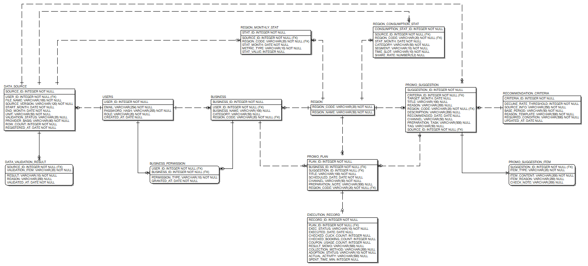
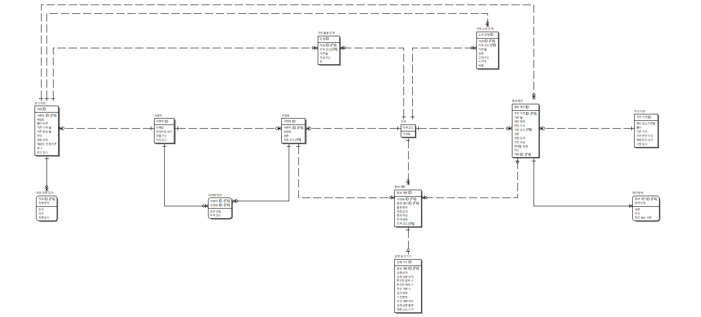
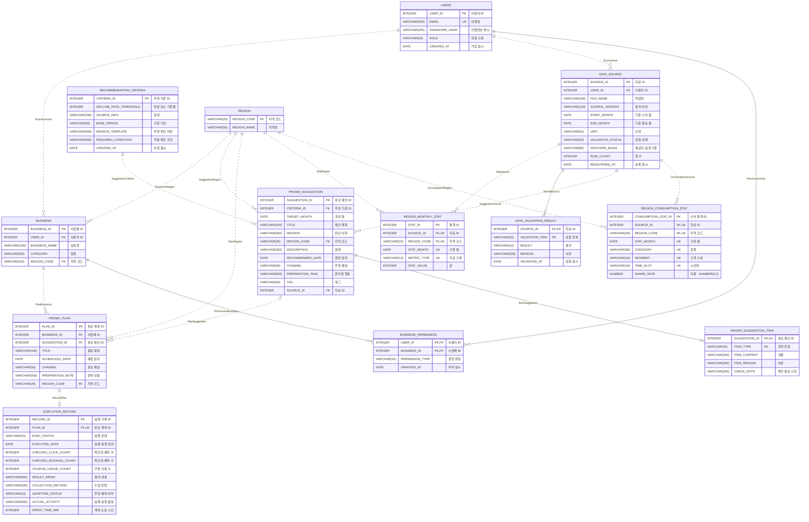

# ERD 수정 내역

- 1차 수정: 2026-10-10 (강의자료 형식 맞추기)
- 2차 수정: 2026-10-11 (팀 수정본의 오류 수정과 화면 시안 기준 반영)
- 3차 수정: 2026-10-11 (ERD 검토 보고서 ①부터 ⑭까지 반영)
- 프로젝트: 제주 비수기 상권 마케팅 캘린더
- 기준 자료: 「[8주차] 정보시스템 프로젝트 설계 Data Modeling」 강의자료 56쪽 (아래에서는 'PDF'로 줄여 씀)
- 화면 기준: 화면 시안 [app.js](../../02_제품/화면시안/app.js), [화면설계서](../../00_제출/Red_SCREEN.md), [ERD 프로토타입 대조 가이드](ERD_프로토타입_대조_가이드.md)
- 원본: 팀이 처음 공유한 [Logical ERD.erwin](<원본/Logical ERD.erwin>), [Physical ERD.erwin](<원본/Physical ERD.erwin>), 1차 수정본을 팀이 고친 [Red_ERD_팀수정_20261011.erwin](원본/Red_ERD_팀수정_20261011.erwin) (모두 ERwin Data Modeler r7.3)
- 결과: [Red_ERD.erwin](Red_ERD.erwin) (Logical/Physical 모델 1개, 엔터티 13개, 속성 90개, 관계 18개), ERwin으로 만든 SQL [Red_ERD_Oracle.sql](Red_ERD_Oracle.sql), [ERD 코드 설계서](ERD_코드_설계서.md)
- 남은 작업: [ERD 수정 가이드](ERD_수정_가이드.md)

## 0. 3차 수정 (검토 보고서 반영)

2026-10-11에 받은 'Red ERD 검토 보고서'의 14개 항목을 모두 반영함 검토 대상은 2차 수정 뒤의 Red_ERD.erwin(엔터티 12, 속성 89, 관계 15)이었음 보고서에서 팀 결정으로 남긴 ③, ⑤, ⑧, ⑩은 화면설계서와 화면 시안의 동작을 근거로 정했고, 정한 내용과 근거를 0.2의 표에 적음

### 0.1 2차 수정에서 놓친 것

보고서 ①의 숨김 속성은 팀 수정본에 이미 있었던 것인데, 2차 수정 때 찾지 못했음

| 엔터티 | Logical Only (논리 화면에만 보임) | Physical Only (물리 화면에만 보임) |
| --- | --- | --- |
| 추천기준 | 방문 감소 기준율, 출처, 기준 기간, 추천 판단 이유, 적용 확인 조건, 수정 일시 | VISIT_DECREASE_CRITERIA NUMBER, SOURCE VARCHAR(100), CRITERIA_PERIOD VARCHAR(50), RECOMMENDATION_REASON VARCHAR(200), VERIFICATION_CONDITION VARCHAR(200), MODIFICATION_DATE DATE |
| 3개월 홍보 일정 | 소요 시간 | DURATION VARCHAR(50) |

2차 수정 때 확인에 쓴 스크립트는 엔터티의 논리 화면 속성 순서 목록만 읽었음 그래서 물리 화면에만 있는 속성 7개를 보지 못했고, '속성 82개'라고 잘못 적었음 (파일에는 89개가 있었음) 2차 수정의 E2, E3에서 영문 이름으로 고친 속성도 논리 전용이라 물리 화면과 SQL에는 나오지 않았음

이번에는 숨김 표시(Is_Logical_Only, Is_Physical_Only)와 관계없이 파일의 모든 속성을 읽어 확인했고, 숨김 속성이 하나도 없음을 확인함

### 0.2 항목별 반영

| 번호 | 보고서 내용 | 반영 | 근거 |
| --- | --- | --- | --- |
| ① | 논리 모델과 물리 모델의 속성이 다름 | 물리 전용 7개를 지움 논리 전용 7개는 숨김 표시가 없는 속성으로 다시 만들어 두 화면에 똑같이 나오게 함 (추천 기준 6개, 소요 시간은 ⑧에 따라 실행 결과 기록으로 옮김) | PDF 38쪽, 44쪽 한 모델에서 논리·물리 전환 |
| ② | DATA_SOURCE.VALIDATION_STATU 오타 | 파일을 다시 읽었을 때 물리 이름은 공백 없는 VALIDATION_STATUS였음 같은 이름으로 다시 저장했고 SQL에도 VALIDATION_STATUS로 나옴 | 보고서 부록의 표에서 이름이 잘려 보인 것으로 판단함 |
| ③ | 월 컬럼 4개가 VARCHAR(10) | 대상 월, 기준 시작 월, 기준 종료 월, 기준 월 4개를 모두 DATE로 바꿈 새 지역 소비 통계의 기준 월도 DATE 매월 1일로 저장함 | PDF 51쪽 날짜형 DATE 2차 수정의 Q6(VARCHAR(10)) 결정을 바꿈 |
| ④ | 소비 비교에 필요한 업종·내외국인·시간대가 없음 | '지역 소비 통계' REGION_CONSUMPTION_STAT 엔터티를 새로 만듦 자료 ID와 지역 코드는 외래키(ConsumptionSource, ConsumptionRegion, 둘 다 Nulls Not Allowed), 기준 월, 업종, 고객 구분, 시간대는 NOT NULL, 비중 SHARE_RATE는 NUMBER(5,2) 같은 행이 두 번 들어가지 않게 AK1(자료 ID, 지역 코드, 기준 월, 업종, 고객 구분, 시간대)을 둠 | 화면설계서 SCR-C-003 소비 비교 ④, ⑤ 화면의 업종별 내·외국인 비중과 시간대별 비중 ([app.js 207줄](../../02_제품/화면시안/app.js#L207)) 비중은 소수라 INTEGER에 담을 수 없어 NUMBER(5,2)로 둠 |
| ⑤ | 활용 사례(UC11) 엔터티가 없음 | 엔터티를 만들지 않고 정적 콘텐츠로 둠 | 화면설계서 SCR-C-002에 사례명·성과 수치는 검증 전 예시이고 별도 사례 상세 화면이 없다고 적혀 있음 ([Red_SCREEN.md](../../00_제출/Red_SCREEN.md)) |
| ⑥ | 홍보 제안과 자료 사이에 관계가 없음 | 홍보 제안에 자료 ID SOURCE_ID(FK) NOT NULL을 더함 관계 이름 SuggestionSource, Nulls Not Allowed | 제안마다 출처·기준을 보여주고 분석 자료를 고르면 제안이 바뀜 (SCR-C-004) |
| ⑦ | 사업체와 홍보 제안의 지역 코드가 Null 허용 | BusinessRegion, SuggestionRegion을 Nulls Not Allowed로 바꾸고 부모 삭제를 SetNull에서 Restrict로 바꿈 PlanSuggestion은 Nulls Allowed 그대로 | 공통 헤더가 사업체 지역을 항상 보여주고, 제안은 지역을 고른 뒤 만들어짐 (SCR-C-004 ①) 직접 계획 추가는 제안 없이 저장함 |
| ⑧ | 소요 시간이 홍보 계획에 있음 | 실행 결과 기록으로 옮김: '계획 소요 시간' SPENT_TIME_MIN INTEGER, NULL 허용 | 기록 입력 팝업(SCR-B-002-P01 ②)에서 입력하고 빈칸은 미측정으로 둠 계획과 기록은 AK1로 1:1이라 기록에 두어도 계획별로 하나씩임 2차 수정의 Q4 결정을 바꿈 |
| ⑨ | REGION_MONTHLY_STAT.UNIT 중복 | 지움 단위는 자료 ID로 등록 자료의 UNIT을 따라가 찾음 | 3정규형 (PDF 34쪽) |
| ⑩ | PROMO_PLAN.REGION_CODE 이행 종속 | 그대로 둠 | 지역 선택이 SCR-C-002, SCR-C-003, SCR-C-004에 있고, 계획은 그때 고른 지역으로 저장됨 ([app.js 485줄](../../02_제품/화면시안/app.js#L485)) 사업체 지역과 다른 지역으로 계획을 세울 수 있어 사업체를 거쳐 알 수 있는 값이 아님 |
| ⑪ | 지역 월별 통계에 대체 키가 없음 | AK1(자료 ID, 지역 코드, 기준 월, 지표 구분)을 만듦 | USERS.EMAIL, EXECUTION_RECORD.PLAN_ID의 AK와 같은 방식 |
| ⑫ | 제안 → 제안 항목 Cardinality | ItemSuggestion을 One or More(P)로 바꿈 | 제안 카드는 항상 시기·대상·상품·관광지 네 항목을 가짐 ([app.js 194줄](../../02_제품/화면시안/app.js#L194)) |
| ⑬ | 코드 설계서 | [ERD 코드 설계서](ERD_코드_설계서.md)를 PDF 55쪽 서식으로 작성함 보고서의 11개 컬럼과 새로 생긴 SEGMENT, TIME_SLOT, CATEGORY까지 14개 VALIDATION_ITEM의 가장 긴 코드는 13자라 VARCHAR(20)에 들어감 | PDF 55쪽 1.6 코드 설계서 |
| ⑭ | 이름 띄어쓰기와 도메인 | 엔터티: 3개월 홍보 일정 → 홍보 계획, 자료 등록 현황 → 등록 자료, 추천기준 → 추천 기준 속성: 역할구분 → 역할 구분, 가입일시 → 가입 일시, 등록일시 → 등록 일시, 검증일시 → 검증 일시, 기준월 → 기준 월, 일정 계획 ID → 홍보 계획 ID, 재검토에서 기준 시작월 → 기준 시작 월, 기준 종료월 → 기준 종료 월, 부여일 → 부여 일시, 권장 날짜 → 권장 일자 (0.6) String 도메인이던 추천 기준 ID 2개를 `<default>`로 바꿈 같은 문제가 있던 MODIFICATION_DATE는 ①에서 지웠고, 지금은 모든 속성의 도메인이 `<default>`임 | 보고서 ⑭의 이름 제안을 그대로 씀 |

보고서 마지막 줄의 Schema Generation 확인은 0.5에 적음

### 0.3 보고서 밖에서 함께 고친 것

| 내용 | 이유 |
| --- | --- |
| 논리 화면의 자료형을 물리 자료형과 같게 맞춤 | 논리 자료형이 모두 ERwin 기본값 CHAR(18)로 남아 있었음 (추천 기준 ID 2개만 VARCHAR(20)) |
| 키 이름을 영문으로 바꿈 (XPKUSERS, XAK1USERS처럼 'X + 키 종류 + 테이블 이름') | 처음 만든 SQL에서 PK, AK 이름이 한글 엔터티 이름으로 나왔음 가장 긴 이름은 XAK1REGION_CONSUMPTION_STAT 27자로 Oracle 이름 길이 30자 안에 들어감 |

### 0.4 배치

엔터티 13개와 관계 18개를 다시 배치함 2차 수정 때는 물리 화면을 확인용 복사본으로 대신 봤지만, 이번에는 ERwin r7.3에서 실제 물리 화면을 열어 확인함 물리 화면은 영문 이름과 자료형, NULL 여부가 함께 보여 상자가 가장 넓음

| 줄 | 엔터티 (왼쪽부터) |
| --- | --- |
| 윗줄 | 지역 월별 통계, 지역 소비 통계 |
| 가운데 줄 | 등록 자료, 사용자, 사업체, 지역, 홍보 제안, 추천 기준 |
| 아랫줄 | 자료 검증 결과, 사업체 권한, 홍보 계획, 제안 항목 |
| 맨 아래 | 실행 결과 기록 |

- 등록 자료에서 홍보 제안(SuggestionSource)과 지역 소비 통계(ConsumptionSource)로 가는 선은 그림 맨 위를 따로 지나가게 해 다른 선, 상자와 겹치지 않게 함
- 물리 화면과 논리 화면 모두에서 상자끼리 겹치지 않고, 관계선이 상자를 지나거나 서로 교차하지 않음

물리 화면

논리 화면

### 0.5 SQL 스키마 생성 결과

물리 화면에서 Tools → Forward Engineer → Schema Generation (PDF 47쪽)을 기본 옵션 그대로 실행하고 Report로 저장함 → [Red_ERD_Oracle.sql](Red_ERD_Oracle.sql)

- 테이블 13개, PK 13개, AK(UNIQUE) 4개, FK 18개이며 모델과 같음
- RecordPlan은 ON DELETE CASCADE, PlanSuggestion은 ON DELETE SET NULL로 나옴
- 테이블, 컬럼, 제약 조건 이름이 모두 영문이고 30자를 넘는 이름이 없음
- ERwin 기본 옵션이라 관계 규칙을 확인하는 트리거 30개도 함께 들어 있음
- Oracle DB에서 실제로 실행해 보지는 않았음 → [가이드 2.3](ERD_수정_가이드.md#23-sql-스키마와-테이블-명세서)

### 0.6 재검토 (2026-10-11)

3차 수정을 올린 뒤, 검토 보고서 원문과 GitHub에 올라간 파일을 처음부터 다시 대조함

| 확인한 것 | 방법 | 결과 |
| --- | --- | --- |
| 올라간 파일 | GitHub, 저장소, 바탕화면의 Red_ERD.erwin 비교 | 세 파일이 같았음 |
| ①부터 ⑭까지 | 파일의 모든 속성, 관계, 키를 다시 읽어 보고서의 요구와 항목별로 대조 | ⑭의 이름 일관성 4곳을 빼고 모두 맞았음 |
| ①의 값 | 추천 기준 6개 컬럼의 자료형과 NULL을 보고서가 적은 값과 대조 | 같음 (방문 감소 기준율 INTEGER NOT NULL부터 수정 일시 DATE NULL까지) |
| SQL | SQL의 테이블, 컬럼, 자료형, NULL, PK, AK, FK를 모델과 하나씩 대조 | 테이블 13개, 컬럼 90개, 키 17개, FK 18개가 모두 같음 |
| 코드 설계서 | 14개 코드의 관련 컬럼 자료형과 가장 긴 코드 길이를 모델과 대조 | 모두 같고 길이 안에 들어감 |
| 다른 문서 | 저장소 전체에서 바뀌기 전 엔터티, 컬럼 이름 검색 | ERD 문서 밖에는 화면 이름 '3개월 홍보 일정표'만 있고 ERD 이름은 없음 |

**재검토에서 고친 것 (⑭)** 같은 종류의 이름끼리 띄어쓰기와 끝말이 달랐던 논리 이름 4개를 맞춤 물리 이름, 자료형, 키, 관계, 배치는 바꾸지 않았음

| 컬럼 | 고치기 전 | 같은 종류의 이름 | 고친 뒤 |
| --- | --- | --- | --- |
| DATA_SOURCE.START_MONTH | 기준 시작월 | 대상 월, 기준 월 | 기준 시작 월 |
| DATA_SOURCE.END_MONTH | 기준 종료월 | 대상 월, 기준 월 | 기준 종료 월 |
| BUSINESS_PERMISSION.GRANTED_AT | 부여일 | 가입 일시, 등록 일시, 검증 일시, 수정 일시 | 부여 일시 |
| PROMO_SUGGESTION.RECOMMENDED_DATE | 권장 날짜 | 예정 일자, 실제 실행 일자 | 권장 일자 |

고친 뒤 ERwin r7.3에서 물리 화면과 논리 화면을 다시 열어 캡처했고(0.4의 그림), 상자와 관계선이 겹치지 않음을 다시 확인함 Schema Generation도 다시 실행했는데 [Red_ERD_Oracle.sql](Red_ERD_Oracle.sql)과 내용이 같았음 (SQL에는 물리 이름만 들어감)

이 PC에는 Oracle DB가 없어 SQL을 실제로 실행해 보는 확인은 여전히 남아 있음 → [가이드 2.3](ERD_수정_가이드.md#23-sql-스키마와-테이블-명세서)

## 1. 2차 수정 (2026-10-11)

팀이 1차 수정본을 고쳐 보낸 파일을 그대로 열어 고침 팀이 맞춘 엔터티 배치를 살리기 위해 새 파일을 만들지 않았음

이 장은 2차 수정 당시의 기록임 3차 수정에서 소요 시간의 위치(⑧), 월 값의 자료형(③), 사업체와 홍보 제안의 지역 코드 Null 여부(⑦), 엔터티와 속성 이름(⑭)이 바뀌었으므로 지금 모델은 [0장](#0-3차-수정-검토-보고서-반영)과 3장, 4장을 봄

### 1.1 팀 수정본에서 그대로 살린 것

| 항목 | 내용 | 근거 |
| --- | --- | --- |
| 엔터티 배치 | 원본과 같은 3줄 배치 | [가이드 2.1](ERD_수정_가이드.md#21-엔터티-배치-맞추기) |
| 소요 시간 이동 | 실행 결과 기록에서 3개월 홍보 일정으로 옮김 | 화면의 입력 칸 이름이 '계획 소요 시간'임 ([361줄](../../02_제품/화면시안/app.js#L361)), 가이드 Q4 |
| 출처와 기준 기간 분리 | 추천기준의 '출처 및 기준 기간'을 두 속성으로 나눔 | 1정규형 원자값 (PDF 32쪽), 가이드 Q1 |
| 결과 내용과 수집 방법 분리 | 실행 결과 기록의 '결과 및 수집 방법'을 두 속성으로 나눔 | 1정규형 원자값 (PDF 32쪽), 가이드 Q2 |
| 기준 시작월·종료월 형식 | START_MONTH, END_MONTH VARCHAR(10) | 화면은 연도와 월(YYYY-MM)만 입력함 ([238줄](../../02_제품/화면시안/app.js#L238)), 가이드 Q6 |
| 클릭·예약·쿠폰 컬럼 이름 | CHECKED_CLICK_COUNT, CHECKED_BOOKING_COUNT, COUPON_USAGE_COUNT | 영문 대문자 규칙(PDF 51쪽)에 맞음 |

출처와 기준 기간, 결과 내용과 수집 방법은 화면 시안에서 각각 입력 칸 하나로 받음 ERD를 나눈 만큼 화면 입력 칸도 나눠야 함 → [가이드 3장](ERD_수정_가이드.md#3-팀이-정해야-하는-부분)

### 1.2 고친 오류

| 번호 | 팀 수정본 | 수정 | 근거 |
| --- | --- | --- | --- |
| E1 | 사업체의 논리 이름 '지역 코드'가 BUSINESS_NAME에, '상호명'이 REGION_CODE에 연결됨 | '상호명'을 BUSINESS_NAME에 다시 연결함 지역 코드는 새 지역 엔터티의 외래키로 다시 만듦 (P27) | 논리 이름과 물리 이름은 같은 값을 뜻해야 함 |
| E2 | 추천기준의 속성 6개와 '수집 방법'의 물리 이름이 한글(방문_감소_기준율 등)이고 자료형이 CHAR(18) | 영문 대문자 이름과 INTEGER, VARCHAR(), DATE로 고침 | PDF 51쪽 |
| E3 | 옮긴 소요 시간이 '소요_시간 INT' | SPENT_TIME_MIN INTEGER | PDF 51쪽 숫자형 INTEGER |
| E4 | 추천 기준 ID만 VARCHAR(20) (다른 ID는 모두 INTEGER) | INTEGER로 되돌림 홍보 제안의 외래키도 함께 바뀜 | PDF 51쪽 숫자형 INTEGER 바꾼 이유가 기록되지 않았음 |
| E5 | '추천 채택 여부' 삭제 | 추천 채택 여부 ADOPTION_STATUS로 다시 만듦 (P15) | 화면이 미확인, 채택, 미채택을 사용자에게 직접 받음 ([361줄](../../02_제품/화면시안/app.js#L361)) 일정의 홍보 제안 ID와 다른 값임 (프로토타입 대조 가이드 Q5) |
| E6 | '주변 관광지', '추천 상품 후보' 삭제 ('홍보 대상'은 남음) | 세 값을 '제안 항목' 엔터티에 항목별로 저장함 (P25) | 화면이 홍보 시기, 홍보 대상, 상품 후보, 주변 관광지마다 내용과 이유를 따로 보여줌 ([194줄](../../02_제품/화면시안/app.js#L194)) |

### 1.3 프로토타입 대조 가이드 반영

P1부터 P27까지 모두 반영함 가이드에서 팀 결정으로 남긴 항목은 화면 시안의 동작을 근거로 정했고, 정한 내용과 이유를 '결정' 칸에 적음

| 번호 | 반영 내용 | 결정과 근거 |
| --- | --- | --- |
| P1 | USERS.EMAIL VARCHAR(254) | |
| P2 | 비밀번호를 '비밀번호 해시' PASSWORD_HASH VARCHAR(255)로 바꿈 | 결정: 비밀번호는 해시 값으로 저장함 해시 방식은 개발 단계에서 정하고, 255자는 그 값을 담기 위한 길이임 |
| P3 | DATA_SOURCE.SOURCE_VERSION VARCHAR(120) | |
| P4 | 출처 SOURCE_INFO VARCHAR(250) | 팀이 나눈 두 속성 중 출처에 화면 제한 250자를 적용함 기준 기간 BASE_PERIOD는 VARCHAR(50) |
| P5 | REASON_TEMPLATE, REQUIRED_CONDITION VARCHAR(500) | |
| P6 | PROMO_PLAN.PREPARATION_NOTE VARCHAR(500) | |
| P7 | 결과 내용 RESULT_MEMO VARCHAR(500) | 나눠진 수집 방법 COLLECTION_METHOD는 VARCHAR(200) |
| P8 | DBMS는 Oracle 그대로 둠 길이 숫자는 화면과 같은 글자 수 기준 | 결정: PDF 38쪽과 모델 설정이 Oracle임 Oracle에서 길이를 글자 수로 세도록 SQL 실행 전에 설정함 → [가이드 2.3](ERD_수정_가이드.md#23-sql-스키마와-테이블-명세서) |
| P9 | PROMO_PLAN의 TITLE, SCHEDULED_DATE, CHANNEL NOT NULL | |
| P10, P14 | '실행 여부'를 '실행 상태' EXEC_STATUS VARCHAR(10) NOT NULL로 바꿈 | 코드값은 1.4 |
| P11 | 추천기준의 기준율, 출처, 기준 기간, 판단 이유, 적용 조건 NOT NULL | 팀이 출처와 기준 기간을 나눠서 다섯 컬럼이 됨 |
| P12 | DATA_SOURCE의 FILE_NAME, SOURCE_VERSION, START_MONTH, END_MONTH, UNIT NOT NULL | |
| P13 | USERS의 EMAIL, PASSWORD_HASH, ROLE NOT NULL, EMAIL UNIQUE | UNIQUE는 Alternate Key(AK1)로 만듦 |
| P15 | 추천 채택 여부 ADOPTION_STATUS VARCHAR(10) NOT NULL | 결정: 방법 2(상태 코드) 실행 상태와 같은 방식이고, 문자형은 VARCHAR()라는 PDF 51쪽 규칙과 맞음 화면은 항상 하나를 고르므로(처음 값은 미확인) NOT NULL |
| P16 | RecordPlan의 Cardinality를 Zero or One으로, EXECUTION_RECORD.PLAN_ID UNIQUE | |
| P17 | ERD는 바꾸지 않음 | 결정: Oracle에서는 제안 ID가 비어 있는 직접 추가 계획까지 막히므로 UNIQUE를 쓰지 않음 같은 제안을 두 번 담지 못하게 하는 확인은 프로그램에서 한다고 테이블 명세서에 적음 → [가이드 2.3](ERD_수정_가이드.md#23-sql-스키마와-테이블-명세서) |
| P18 | RecordPlan의 부모 삭제(Parent Delete)를 Cascade로 바꿈 | |
| P19 | EXECUTION_RECORD에 실제 실행 활동 ACTUAL_ACTIVITY VARCHAR(500) | |
| P20 | DATA_SOURCE에 PROVIDER_BASIS VARCHAR(80), ROW_COUNT INTEGER, REGISTERED_AT DATE (모두 NOT NULL) | |
| P21 | PROMO_SUGGESTION에 DESCRIPTION, RECOMMENDED_DATE, CHANNEL, PREPARATION_TASK, TAG | |
| P22 | PROMO_PLAN에 지역 코드(FK) NOT NULL | 결정: 화면이 계획마다 그때 고른 분석 지역을 저장하고 ([485줄](../../02_제품/화면시안/app.js#L485)), 분석 지역은 바꿀 수 있어 사업체 지역과 다를 수 있음 |
| P23 | '자료 검증 결과' 엔터티 PK는 자료 ID(FK)와 검증 항목, DATA_SOURCE와 식별 관계 ResultSource | 가이드의 '바꾸기로 하면'대로 만듦 |
| P24 | '지역 월별 통계' 엔터티 DATA_SOURCE(StatSource), 지역(StatRegion)과 1:N 비식별 관계 | 값 STAT_VALUE는 INTEGER, NULL 허용 화면 예시 값이 정수이고 빈 값은 null임 ([86줄](../../02_제품/화면시안/app.js#L86)) |
| P25 | '제안 항목' 엔터티 PK는 홍보 제안 ID(FK)와 항목 유형, 홍보 제안과 식별 관계 ItemSuggestion 홍보 대상, 주변 관광지, 상품 후보는 이 엔터티로 옮김 | 가이드의 '바꾸기로 하면'대로 만듦 |
| P26 | '사업체 권한' 엔터티 PK는 사용자 ID(FK)와 사업체 ID(FK), 사용자·사업체와 식별 관계 (PDF 41쪽, 50쪽의 M:N 해소) | 사업체의 사용자 ID(소유자)는 그대로 둠 |
| P27 | '지역' 엔터티 (지역 코드 PK, 지역명) 사업체, 홍보 제안, 3개월 홍보 일정, 지역 월별 통계의 지역 코드를 외래키로 연결 | 사업체와 홍보 제안은 원래처럼 NULL 허용, 일정(P22)과 통계는 화면과 CSV에서 항상 있는 값이라 NOT NULL |

데이터 표준화(PDF 13쪽)에 따라 홍보 제안의 대상 월 TARGET_MONTH도 DATE에서 VARCHAR(10)으로 바꿔 다른 월 값과 같은 형식으로 맞춤

### 1.4 코드값 (코드 설계서 초안)

3차 수정에서 PDF 55쪽 서식의 [ERD 코드 설계서](ERD_코드_설계서.md)로 옮겨 정리함 아래는 2차 수정 당시의 초안이며, 지역 월별 통계의 단위 컬럼은 3차 수정에서 지웠음

| 컬럼 | 코드 | 뜻 | 근거 |
| --- | --- | --- | --- |
| USERS.ROLE | BUSINESS, SERVICE | 사업체 운영자, 서비스 운영자 | [289줄](../../02_제품/화면시안/app.js#L289) |
| EXECUTION_RECORD.EXEC_STATUS | DONE, NOT_DONE, CHECKING | 실행함, 미실행, 확인 중 | [361줄](../../02_제품/화면시안/app.js#L361), P14 |
| EXECUTION_RECORD.ADOPTION_STATUS | YES, NO, UNKNOWN | 채택, 미채택, 미확인 | [361줄](../../02_제품/화면시안/app.js#L361) |
| DATA_VALIDATION_RESULT.VALIDATION_ITEM | PERIOD, AGGREGATION, REGION_CODE, MISSING_VALUE, PROVIDER | 자료 기간, 집계 기준, 지역 코드, 누락값, 제공 기준 일관성 | [263줄](../../02_제품/화면시안/app.js#L263), UC08 |
| DATA_VALIDATION_RESULT.RESULT | PASS, FAIL | 통과, 실패 | P23 |
| REGION_MONTHLY_STAT.METRIC_TYPE | VISIT, SPEND | 방문, 소비 | [86줄](../../02_제품/화면시안/app.js#L86) |
| PROMO_SUGGESTION_ITEM.ITEM_TYPE | TIMING, AUDIENCE, PRODUCT, ATTRACTION | 홍보 시기, 홍보 대상, 상품 후보, 주변 관광지 | [194줄](../../02_제품/화면시안/app.js#L194) |
| BUSINESS_PERMISSION.PERMISSION_TYPE | OWNER, MANAGER | 소유, 관리 | P26 |
| REGION.REGION_CODE | 50110253, 50110256 | 애월읍, 구좌읍 | [265줄](../../02_제품/화면시안/app.js#L265) |
| DATA_SOURCE.UNIT, REGION_MONTHLY_STAT.UNIT | 만 명, 억 원 | 방문 단위, 소비 단위 | [238줄](../../02_제품/화면시안/app.js#L238) |

### 1.5 배치 정리

2차 수정 직후에는 새 엔터티 5개가 왼쪽 위에 겹쳐 있었고, 새 관계선이 그림 전체를 가로질렀음 ERwin 화면에서 상자가 저장된 크기보다 넓게 그려져 기존 상자끼리도 겹쳤음 그래서 엔터티 12개의 위치와 관계선 15개의 경로를 다시 정함

| 바꾼 것 | 내용 |
| --- | --- |
| 엔터티 위치 | 관계가 있는 엔터티끼리 이웃하게 다시 놓음 배치표는 [가이드 2.1](ERD_수정_가이드.md#21-엔터티-배치-맞추기) |
| 관계선 경로 | 연결 면, 면 위의 연결 위치, 꺾이는 지점을 정해 모든 선이 직선이거나 한 번만 꺾이게 함 |
| 간격 | 물리 화면에서 영문 이름과 자료형 때문에 상자가 넓어져도 겹치지 않게 열 사이를 넓힘 |

엔터티, 속성, 관계, 키, 삭제 규칙은 바꾸지 않았음 바꾸기 전 파일과 다시 읽어 비교했을 때 위치를 뺀 모든 값이 같았음

3차 수정에서 엔터티 13개, 관계 18개로 다시 배치함 → [0.4](#04-배치)

## 2. 1차 수정 (2026-10-10)

팀이 처음 공유한 논리·물리 파일 두 개를 PDF의 작성 방법에 맞춘 내용임 아래는 그때의 기록이며, 지금 모델은 3장과 4장을 봄

### 2.1 한눈에 보기

| 번호 | 항목 | 원본 | 수정 결과 | PDF 근거 |
| --- | --- | --- | --- | --- |
| 1 | 모델 종류 | 논리 전용(Logical) 파일과 물리 전용(Physical) 파일을 따로 작성 | **Logical/Physical 모델 1개**로 합침 논리 화면은 한글 이름, 물리 화면은 영문 이름 | 38쪽 모델 타입 Logical/Physical, 44쪽 같은 모델에서 Physical Model로 전환 |
| 2 | DBMS | Oracle 10 | Oracle 10 유지 | 38쪽 DBMS Oracle |
| 3 | 표기법 | IDEF1X (◇·● 기호) | **IE 표기법** (까마귀발 기호) | 38쪽 IE 표기법으로 변경, 26쪽부터 28쪽까지 IE 관계 표기 |
| 4 | 관계 이름 | R/1, R/2 같은 기본 이름 | BusinessUser처럼 자식·부모 순서의 영문 이름 | 42쪽 R/1 → BookPublisher 예시 |
| 5 | 관계 Null Option | 6개 모두 Nulls Allowed | 5개 **Nulls Not Allowed**, 1개는 Nulls Allowed 유지 | 42쪽 Null Option 변경 |
| 6 | 물리 컬럼 이름 | 소문자 (user_id) | **영문 대문자** (USER_ID) | 51쪽 개체 및 속성 명 영문 대문자로 변경 |
| 7 | 물리 자료형 | 50개 모두 CHAR(18) (ERwin 기본값) | 숫자 INTEGER, 문자 VARCHAR(), 날짜 DATE, 여부 값 CHAR(1) | 51쪽 숫자형 INTEGER·문자형 VARCHAR()·날짜형 DATE, 54쪽 예시의 CHAR(1) |
| 8 | 논리·물리 속성 연결 | 홍보 제안의 '주변 관광지'·'추천 상품 후보'와 물리 컬럼의 순서가 서로 어긋남 | 이름 뜻에 맞게 ATTRACTION_INFO, PRODUCT_CANDIDATE로 연결 | 1번과 같이 한 모델에서 논리·물리 이름을 함께 관리 |

1차 수정에서는 엔터티·속성·관계의 내용을 원본 그대로 두었음 관계선 위 동사구는 PDF 26쪽의 '초록색 텍스트에 해당하는 내용을 작성하지 않음'에 따라 쓰지 않았고, 이 원칙은 2차 수정에도 그대로 적용함

### 2.2 1차 관계 수정

관계 이름은 PDF 42쪽의 BookPublisher(자식 Book, 부모 Publisher)처럼 자식 다음에 부모를 붙임 2차 수정에서 새로 만든 관계도 같은 방식임

| Parent | Child | 기존 이름 | 수정 이름 | Null Option | 판단 근거 |
| --- | --- | --- | --- | --- | --- |
| 사용자 | 사업체 | R/1 | BusinessUser | Nulls Not Allowed | 사업체는 반드시 사용자 계정에 속함 |
| 사용자 | 자료 등록 현황 | R/2 | SourceUser | Nulls Not Allowed | CSV는 서비스 운영자가 등록함 (UC07) |
| 추천기준 | 홍보 제안 | R/4 | SuggestionCriteria | Nulls Not Allowed | 제안은 추천 기준과 근거를 바탕으로 판단 이유와 함께 보여줌 (UC02, UC09) |
| 사업체 | 3개월 홍보 일정 | R/5 | PlanBusiness | Nulls Not Allowed | 일정은 사업체별로 저장함 (F03) |
| 홍보 제안 | 3개월 홍보 일정 | R/7 | PlanSuggestion | **Nulls Allowed 유지** | [화면설계서](../../00_제출/Red_SCREEN.md)의 '월별 직접 추가'로 제안 없이도 일정을 저장할 수 있음 |
| 3개월 홍보 일정 | 실행 결과 기록 | R/8 | RecordPlan | Nulls Not Allowed | 실행 기록은 저장한 일정에 대해 남김 (UC04) 2차 수정에서 Zero or One과 Cascade를 더함 |

## 3. 현재 테이블과 컬럼 (3차 수정 후)

Red_ERD.erwin을 다시 읽어 만든 표임 키 칸의 FK는 관계로 이전된 외래키, UNIQUE는 Alternate Key임 한 테이블에서 여러 컬럼에 UNIQUE가 있으면 그 컬럼들을 묶은 하나의 Alternate Key임 월 값(대상 월, 기준 시작 월, 기준 종료 월, 기준 월)은 DATE이며 매월 1일로 저장함

**USERS (사용자)**

| 논리 이름 | 물리 이름 | 자료형 | NULL | 키 |
| --- | --- | --- | --- | --- |
| 사용자 ID | USER_ID | INTEGER | NOT NULL | PK |
| 이메일 | EMAIL | VARCHAR(254) | NOT NULL | UNIQUE |
| 비밀번호 해시 | PASSWORD_HASH | VARCHAR(255) | NOT NULL |  |
| 역할 구분 | ROLE | VARCHAR(20) | NOT NULL |  |
| 가입 일시 | CREATED_AT | DATE | NULL |  |

**BUSINESS (사업체)**

| 논리 이름 | 물리 이름 | 자료형 | NULL | 키 |
| --- | --- | --- | --- | --- |
| 사업체 ID | BUSINESS_ID | INTEGER | NOT NULL | PK |
| 사용자 ID | USER_ID | INTEGER | NOT NULL | FK |
| 상호명 | BUSINESS_NAME | VARCHAR(100) | NULL |  |
| 업종 | CATEGORY | VARCHAR(50) | NULL |  |
| 지역 코드 | REGION_CODE | VARCHAR(20) | NOT NULL | FK |

**PROMO_PLAN (홍보 계획)**

| 논리 이름 | 물리 이름 | 자료형 | NULL | 키 |
| --- | --- | --- | --- | --- |
| 홍보 계획 ID | PLAN_ID | INTEGER | NOT NULL | PK |
| 사업체 ID | BUSINESS_ID | INTEGER | NOT NULL | FK |
| 홍보 제안 ID | SUGGESTION_ID | INTEGER | NULL | FK |
| 활동 제목 | TITLE | VARCHAR(100) | NOT NULL |  |
| 예정 일자 | SCHEDULED_DATE | DATE | NOT NULL |  |
| 홍보 채널 | CHANNEL | VARCHAR(50) | NOT NULL |  |
| 준비 내용 | PREPARATION_NOTE | VARCHAR(500) | NULL |  |
| 지역 코드 | REGION_CODE | VARCHAR(20) | NOT NULL | FK |

**RECOMMENDATION_CRITERIA (추천 기준)**

| 논리 이름 | 물리 이름 | 자료형 | NULL | 키 |
| --- | --- | --- | --- | --- |
| 추천 기준 ID | CRITERIA_ID | INTEGER | NOT NULL | PK |
| 방문 감소 기준율 | DECLINE_RATE_THRESHOLD | INTEGER | NOT NULL |  |
| 출처 | SOURCE_INFO | VARCHAR(250) | NOT NULL |  |
| 기준 기간 | BASE_PERIOD | VARCHAR(50) | NOT NULL |  |
| 추천 판단 이유 | REASON_TEMPLATE | VARCHAR(500) | NOT NULL |  |
| 적용 확인 조건 | REQUIRED_CONDITION | VARCHAR(500) | NOT NULL |  |
| 수정 일시 | UPDATED_AT | DATE | NULL |  |

**PROMO_SUGGESTION (홍보 제안)**

| 논리 이름 | 물리 이름 | 자료형 | NULL | 키 |
| --- | --- | --- | --- | --- |
| 홍보 제안 ID | SUGGESTION_ID | INTEGER | NOT NULL | PK |
| 추천 기준 ID | CRITERIA_ID | INTEGER | NOT NULL | FK |
| 대상 월 | TARGET_MONTH | DATE | NULL |  |
| 제안 제목 | TITLE | VARCHAR(100) | NULL |  |
| 판단 이유 | REASON | VARCHAR(200) | NULL |  |
| 지역 코드 | REGION_CODE | VARCHAR(20) | NOT NULL | FK |
| 설명 | DESCRIPTION | VARCHAR(200) | NULL |  |
| 권장 일자 | RECOMMENDED_DATE | DATE | NULL |  |
| 추천 채널 | CHANNEL | VARCHAR(50) | NULL |  |
| 준비할 행동 | PREPARATION_TASK | VARCHAR(500) | NULL |  |
| 태그 | TAG | VARCHAR(50) | NULL |  |
| 자료 ID | SOURCE_ID | INTEGER | NOT NULL | FK |

**EXECUTION_RECORD (실행 결과 기록)**

| 논리 이름 | 물리 이름 | 자료형 | NULL | 키 |
| --- | --- | --- | --- | --- |
| 실행 기록 ID | RECORD_ID | INTEGER | NOT NULL | PK |
| 홍보 계획 ID | PLAN_ID | INTEGER | NOT NULL | FK, UNIQUE |
| 실행 상태 | EXEC_STATUS | VARCHAR(10) | NOT NULL |  |
| 실제 실행 일자 | EXECUTED_DATE | DATE | NULL |  |
| 확인한 클릭 수 | CHECKED_CLICK_COUNT | INTEGER | NULL |  |
| 확인한 예약 수 | CHECKED_BOOKING_COUNT | INTEGER | NULL |  |
| 쿠폰 사용 수 | COUPON_USAGE_COUNT | INTEGER | NULL |  |
| 결과 내용 | RESULT_MEMO | VARCHAR(500) | NULL |  |
| 수집 방법 | COLLECTION_METHOD | VARCHAR(200) | NULL |  |
| 추천 채택 여부 | ADOPTION_STATUS | VARCHAR(10) | NOT NULL |  |
| 실제 실행 활동 | ACTUAL_ACTIVITY | VARCHAR(500) | NULL |  |
| 계획 소요 시간 | SPENT_TIME_MIN | INTEGER | NULL |  |

**DATA_SOURCE (등록 자료)**

| 논리 이름 | 물리 이름 | 자료형 | NULL | 키 |
| --- | --- | --- | --- | --- |
| 자료 ID | SOURCE_ID | INTEGER | NOT NULL | PK |
| 사용자 ID | USER_ID | INTEGER | NOT NULL | FK |
| 파일명 | FILE_NAME | VARCHAR(100) | NOT NULL |  |
| 출처 버전 | SOURCE_VERSION | VARCHAR(120) | NOT NULL |  |
| 기준 시작 월 | START_MONTH | DATE | NOT NULL |  |
| 기준 종료 월 | END_MONTH | DATE | NOT NULL |  |
| 단위 | UNIT | VARCHAR(50) | NOT NULL |  |
| 검증 상태 | VALIDATION_STATUS | VARCHAR(20) | NULL |  |
| 제공자·집계 기준 | PROVIDER_BASIS | VARCHAR(80) | NOT NULL |  |
| 행 수 | ROW_COUNT | INTEGER | NOT NULL |  |
| 등록 일시 | REGISTERED_AT | DATE | NOT NULL |  |

**REGION (지역)**

| 논리 이름 | 물리 이름 | 자료형 | NULL | 키 |
| --- | --- | --- | --- | --- |
| 지역 코드 | REGION_CODE | VARCHAR(20) | NOT NULL | PK |
| 지역명 | REGION_NAME | VARCHAR(50) | NOT NULL |  |

**REGION_MONTHLY_STAT (지역 월별 통계)**

| 논리 이름 | 물리 이름 | 자료형 | NULL | 키 |
| --- | --- | --- | --- | --- |
| 통계 ID | STAT_ID | INTEGER | NOT NULL | PK |
| 자료 ID | SOURCE_ID | INTEGER | NOT NULL | FK, UNIQUE |
| 지역 코드 | REGION_CODE | VARCHAR(20) | NOT NULL | FK, UNIQUE |
| 기준 월 | STAT_MONTH | DATE | NOT NULL | UNIQUE |
| 지표 구분 | METRIC_TYPE | VARCHAR(10) | NOT NULL | UNIQUE |
| 값 | STAT_VALUE | INTEGER | NULL |  |

**DATA_VALIDATION_RESULT (자료 검증 결과)**

| 논리 이름 | 물리 이름 | 자료형 | NULL | 키 |
| --- | --- | --- | --- | --- |
| 자료 ID | SOURCE_ID | INTEGER | NOT NULL | PK, FK |
| 검증 항목 | VALIDATION_ITEM | VARCHAR(20) | NOT NULL | PK |
| 결과 | RESULT | VARCHAR(10) | NOT NULL |  |
| 사유 | REASON | VARCHAR(200) | NULL |  |
| 검증 일시 | VALIDATED_AT | DATE | NOT NULL |  |

**PROMO_SUGGESTION_ITEM (제안 항목)**

| 논리 이름 | 물리 이름 | 자료형 | NULL | 키 |
| --- | --- | --- | --- | --- |
| 홍보 제안 ID | SUGGESTION_ID | INTEGER | NOT NULL | PK, FK |
| 항목 유형 | ITEM_TYPE | VARCHAR(20) | NOT NULL | PK |
| 내용 | ITEM_CONTENT | VARCHAR(200) | NOT NULL |  |
| 이유 | ITEM_REASON | VARCHAR(200) | NULL |  |
| 확인 필요 사항 | CHECK_NOTE | VARCHAR(200) | NULL |  |

**BUSINESS_PERMISSION (사업체 권한)**

| 논리 이름 | 물리 이름 | 자료형 | NULL | 키 |
| --- | --- | --- | --- | --- |
| 사용자 ID | USER_ID | INTEGER | NOT NULL | PK, FK |
| 사업체 ID | BUSINESS_ID | INTEGER | NOT NULL | PK, FK |
| 권한 유형 | PERMISSION_TYPE | VARCHAR(10) | NOT NULL |  |
| 부여 일시 | GRANTED_AT | DATE | NOT NULL |  |

**REGION_CONSUMPTION_STAT (지역 소비 통계)**

| 논리 이름 | 물리 이름 | 자료형 | NULL | 키 |
| --- | --- | --- | --- | --- |
| 소비 통계 ID | CONSUMPTION_STAT_ID | INTEGER | NOT NULL | PK |
| 자료 ID | SOURCE_ID | INTEGER | NOT NULL | FK, UNIQUE |
| 지역 코드 | REGION_CODE | VARCHAR(20) | NOT NULL | FK, UNIQUE |
| 기준 월 | STAT_MONTH | DATE | NOT NULL | UNIQUE |
| 업종 | CATEGORY | VARCHAR(50) | NOT NULL | UNIQUE |
| 고객 구분 | SEGMENT | VARCHAR(10) | NOT NULL | UNIQUE |
| 시간대 | TIME_SLOT | VARCHAR(10) | NOT NULL | UNIQUE |
| 비중 | SHARE_RATE | NUMBER(5,2) | NULL |  |

## 4. 현재 관계 (3차 수정 후)

관계의 Cardinality는 대부분 0개 이상(Zero, One or More)이고, RecordPlan은 0개 또는 1개(Zero or One), ItemSuggestion은 1개 이상(One or More)임 식별 관계는 실선, 비식별 관계는 점선으로 그려짐 (PDF 28쪽) Nulls Allowed인 관계는 PlanSuggestion 하나뿐임

| 관계 이름 | Parent | Child | Type | Null Option | Cardinality | 부모 삭제 |
| --- | --- | --- | --- | --- | --- | --- |
| BusinessUser | 사용자 | 사업체 | Non-Identifying | Nulls Not Allowed | Zero, One or More | Restrict |
| SourceUser | 사용자 | 등록 자료 | Non-Identifying | Nulls Not Allowed | Zero, One or More | Restrict |
| SuggestionCriteria | 추천 기준 | 홍보 제안 | Non-Identifying | Nulls Not Allowed | Zero, One or More | Restrict |
| PlanBusiness | 사업체 | 홍보 계획 | Non-Identifying | Nulls Not Allowed | Zero, One or More | Restrict |
| PlanSuggestion | 홍보 제안 | 홍보 계획 | Non-Identifying | Nulls Allowed | Zero, One or More | SetNull |
| RecordPlan | 홍보 계획 | 실행 결과 기록 | Non-Identifying | Nulls Not Allowed | Zero or One | Cascade |
| BusinessRegion | 지역 | 사업체 | Non-Identifying | Nulls Not Allowed | Zero, One or More | Restrict |
| SuggestionRegion | 지역 | 홍보 제안 | Non-Identifying | Nulls Not Allowed | Zero, One or More | Restrict |
| PlanRegion | 지역 | 홍보 계획 | Non-Identifying | Nulls Not Allowed | Zero, One or More | Restrict |
| StatSource | 등록 자료 | 지역 월별 통계 | Non-Identifying | Nulls Not Allowed | Zero, One or More | Restrict |
| StatRegion | 지역 | 지역 월별 통계 | Non-Identifying | Nulls Not Allowed | Zero, One or More | Restrict |
| ResultSource | 등록 자료 | 자료 검증 결과 | Identifying | 해당 없음 (식별) | Zero, One or More | Restrict |
| ItemSuggestion | 홍보 제안 | 제안 항목 | Identifying | 해당 없음 (식별) | One or More | Restrict |
| PermissionUser | 사용자 | 사업체 권한 | Identifying | 해당 없음 (식별) | Zero, One or More | Restrict |
| PermissionBusiness | 사업체 | 사업체 권한 | Identifying | 해당 없음 (식별) | Zero, One or More | Restrict |
| SuggestionSource | 등록 자료 | 홍보 제안 | Non-Identifying | Nulls Not Allowed | Zero, One or More | Restrict |
| ConsumptionSource | 등록 자료 | 지역 소비 통계 | Non-Identifying | Nulls Not Allowed | Zero, One or More | Restrict |
| ConsumptionRegion | 지역 | 지역 소비 통계 | Non-Identifying | Nulls Not Allowed | Zero, One or More | Restrict |

## 5. 파일

| 파일 | 내용 |
| --- | --- |
| [Red_ERD.erwin](Red_ERD.erwin) | 3차 수정한 Logical/Physical 모델 ERwin r7.3에서 열고, 도구 모음의 Logical/Physical 선택으로 두 화면을 전환함 |
| [Red_ERD_Oracle.sql](Red_ERD_Oracle.sql) | Red_ERD.erwin의 물리 모델로 Schema Generation을 실행해 만든 Oracle SQL (0.5) |
| [ERD_코드_설계서.md](ERD_코드_설계서.md) | 코드값 컬럼 14개의 코드 설계서 (PDF 55쪽 서식) |
| [원본/Red_ERD_팀수정_20261011.erwin](원본/Red_ERD_팀수정_20261011.erwin) | 1차 수정본을 팀이 고쳐 보낸 파일 변경하지 않음 |
| [원본/Logical ERD.erwin](<원본/Logical ERD.erwin>) | 팀이 처음 공유한 논리 모델 변경하지 않음 |
| [원본/Physical ERD.erwin](<원본/Physical ERD.erwin>) | 팀이 처음 공유한 물리 모델 변경하지 않음 |
| [물리 모델 캡처](../../06_증빙/ERD/20261011_물리모델_배치.png), [논리 모델 캡처](../../06_증빙/ERD/20261011_논리모델_배치.png) | ERwin r7.3에서 Red_ERD.erwin을 열어 캡처한 그림 |

## 6. 수정 방법과 확인 결과

### 수정 방법

1차부터 3차까지 모두 ERwin r7.3에 들어 있는 자동화 기능(SCAPI)으로 고침 1차는 원본 두 파일의 내용으로 Logical/Physical 모델을 새로 만들었고, 2차는 팀 수정본을, 3차는 2차 결과를 직접 열어 고친 뒤 저장함 SQL은 ERwin 화면에서 Schema Generation을 실행해 만듦 원본 파일들은 고치지 않았음

### 확인한 내용

저장한 Red_ERD.erwin을 다시 열어 아래 내용을 확인함

- 모델 종류 Logical/Physical, 대상 DBMS Oracle, 논리·물리 표기법 모두 IE
- 엔터티 13개, 속성 90개, 관계 18개 숨김 표시와 관계없이 모든 속성을 읽어 셌고, Logical Only나 Physical Only 속성이 없으며 90개 모두 논리 화면과 물리 화면에 함께 나옴
- 3장과 4장의 표, 7장의 미리보기는 이 파일을 다시 읽어 만든 것임
- 검토 보고서 ①부터 ⑭까지의 반영 결과와 SQL을 확인 항목 27개로 다시 확인했고 모두 통과함
- 물리 이름이 모두 영문 대문자이고, CHAR(18)이나 INT로 남은 컬럼이 없음 논리 자료형과 물리 자료형이 모두 같고, 도메인은 모두 `<default>`임
- SQL은 0.5와 같음
- ERwin r7.3으로 물리 화면과 논리 화면을 열어 캡처함 상자 13개가 겹치지 않고, 관계선 18개가 상자를 지나거나 서로 교차하지 않음 (0.4)

### 확인하지 못한 내용

- 만든 SQL을 Oracle DB에서 실행해 보지는 못했음 (이 작업 환경에 Oracle DB가 없음)
- 원본 파일은 ERwin 15.2에서 'The file could not be upgraded to the current metamodel level'로 열리지 않았음 Red_ERD.erwin도 같은 r7.3 형식이라 팀 전원이 r7.3으로 작업해야 함

## 7. GitHub 확인용 미리보기

ERwin 화면이 아니라, 수정한 모델 내용을 GitHub에서 바로 볼 수 있게 옮긴 그림임 배치는 자동으로 정해짐 실선은 식별 관계, 점선은 비식별 관계임 `||`는 반드시 1개, `|o`는 0개 또는 1개, `o{`는 0개 이상, `|{`는 1개 이상, `o|`는 0개 또는 1개를 뜻함 UK는 UNIQUE이고, 컬럼 옆 글자는 논리 이름임 비중 SHARE_RATE의 자료형은 미리보기에서 쉼표를 쓸 수 없어 NUMBER로 적고 논리 이름 옆에 NUMBER(5,2)를 함께 적음

