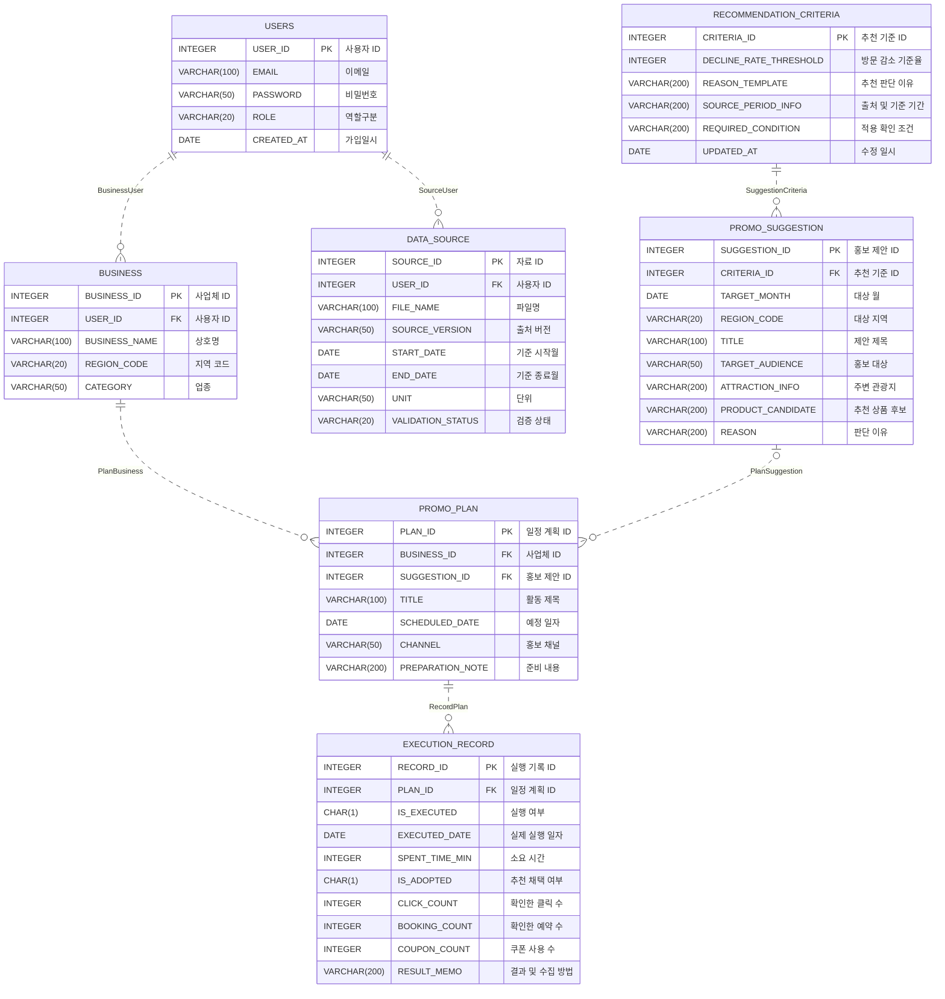

# ERD 수정 내역

- 수정일: 2026-10-10
- 프로젝트: 제주 비수기 상권 마케팅 캘린더
- 기준 자료: 「[8주차] 정보시스템 프로젝트 설계 Data Modeling」 강의자료 56쪽 (아래에서는 'PDF'로 줄여 씀)
- 원본: 팀이 공유한 [Logical ERD.erwin](<원본/Logical ERD.erwin>), [Physical ERD.erwin](<원본/Physical ERD.erwin>) (ERwin Data Modeler r7.3)
- 결과: [Red_ERD.erwin](Red_ERD.erwin) (Logical/Physical 모델 1개)
- 남은 작업: [ERD 수정 가이드](ERD_수정_가이드.md)

## 1. 한눈에 보기

PDF의 작성 방법과 다른 부분 8개를 고침 엔터티·속성·관계의 내용은 원본 그대로 두고, PDF가 정한 설정과 물리 모델 규칙만 적용함

| 번호 | 항목 | 원본 | 수정 결과 | PDF 근거 |
| --- | --- | --- | --- | --- |
| 1 | 모델 종류 | 논리 전용(Logical) 파일과 물리 전용(Physical) 파일을 따로 작성 | **Logical/Physical 모델 1개**로 합침 논리 화면은 한글 이름, 물리 화면은 영문 이름 | 38쪽 모델 타입 Logical/Physical, 44쪽 같은 모델에서 Physical Model로 전환 |
| 2 | DBMS | Oracle 10 | Oracle 10 유지 | 38쪽 DBMS Oracle |
| 3 | 표기법 | IDEF1X (◇·● 기호) | **IE 표기법** (까마귀발 기호) | 38쪽 IE 표기법으로 변경, 26쪽부터 28쪽까지 IE 관계 표기 |
| 4 | 관계 이름 | R/1, R/2 같은 기본 이름 | BusinessUser처럼 자식·부모 순서의 영문 이름 | 42쪽 R/1 → BookPublisher 예시 |
| 5 | 관계 Null Option | 6개 모두 Nulls Allowed | 5개 **Nulls Not Allowed**, 1개는 Nulls Allowed 유지 | 42쪽 Null Option 변경 |
| 6 | 물리 컬럼 이름 | 소문자 (user_id) | **영문 대문자** (USER_ID) | 51쪽 개체 및 속성 명 영문 대문자로 변경 |
| 7 | 물리 자료형 | 50개 모두 CHAR(18) (ERwin 기본값) | 숫자 INTEGER, 문자 VARCHAR(), 날짜 DATE, 여부 값 CHAR(1) | 51쪽 숫자형 INTEGER·문자형 VARCHAR()·날짜형 DATE, 54쪽 예시의 CHAR(1) |
| 8 | 논리·물리 속성 연결 | 홍보 제안의 '주변 관광지'·'추천 상품 후보'와 물리 컬럼의 순서가 서로 어긋남 | 이름 뜻에 맞게 ATTRACTION_INFO, PRODUCT_CANDIDATE로 연결 | 1번과 같이 한 모델에서 논리·물리 이름을 함께 관리 |

## 2. 그대로 둔 내용

- 엔터티 7개, 속성 50개의 논리 이름, 테이블 영문 이름, 기본키, 관계 6개의 부모·자식 방향
- 모든 관계의 비식별 관계(점선)와 Zero, One or More 카디널리티 PDF 42쪽 예시와 같은 설정임
- 관계선 위 동사구는 쓰지 않음 PDF 26쪽에 '초록색 텍스트에 해당하는 내용을 작성하지 않음'으로 표시됨
- 일반 속성의 NULL 허용 클릭·예약·쿠폰처럼 구하지 못한 값을 0으로 바꾸지 않는다는 [유스케이스 기준](../../00_제출/Red_USECASE.md)과 맞음
- 새 엔터티·속성은 추가하지 않음 정규화 관점에서 확인이 필요한 부분은 [가이드의 3장](ERD_수정_가이드.md#3-팀이-정해야-하는-부분)에 질문으로 남김

## 3. 관계 수정

PDF 42쪽 표와 같은 형식으로 정리함 관계 이름은 PDF의 BookPublisher(자식 Book, 부모 Publisher)처럼 자식 다음에 부모를 붙임

| Parent | Child | 기존 이름 | 수정 이름 | Type | Null Option | 판단 근거 |
| --- | --- | --- | --- | --- | --- | --- |
| 사용자 | 사업체 | R/1 | BusinessUser | Non-Identifying | Nulls Not Allowed | 사업체 운영자는 본인 사업체의 계획·기록을 이용함 사업체는 반드시 사용자 계정에 속함 |
| 사용자 | 자료 등록 현황 | R/2 | SourceUser | Non-Identifying | Nulls Not Allowed | CSV는 서비스 운영자가 등록함 (UC07) |
| 추천기준 | 홍보 제안 | R/4 | SuggestionCriteria | Non-Identifying | Nulls Not Allowed | 제안은 추천 기준과 근거를 바탕으로 판단 이유와 함께 보여줌 (UC02, UC09) |
| 사업체 | 3개월 홍보 일정 | R/5 | PlanBusiness | Non-Identifying | Nulls Not Allowed | 일정은 사업체별로 저장함 (F03) |
| 홍보 제안 | 3개월 홍보 일정 | R/7 | PlanSuggestion | Non-Identifying | **Nulls Allowed 유지** | [화면설계서](../../00_제출/Red_SCREEN.md)의 '월별 직접 추가'로 제안 없이도 일정을 저장할 수 있음 |
| 3개월 홍보 일정 | 실행 결과 기록 | R/8 | RecordPlan | Non-Identifying | Nulls Not Allowed | 실행 기록은 저장한 일정에 대해 남김 (UC04) |

물리 원본 파일에서는 같은 관계 번호가 R/1, R/2, R/3, R/4, R/5, R/8로 논리 파일과 달랐음 두 파일을 따로 그리면 이런 차이가 생기므로 1번처럼 한 모델로 합침

## 4. 테이블과 컬럼

원본 물리 파일은 모든 컬럼이 소문자 이름과 CHAR(18)이었음 아래 표의 물리 이름은 원본 이름을 대문자로만 바꾼 것임 (FK)는 관계로 자동 이전된 외래키임

EMAIL VARCHAR(100), PASSWORD VARCHAR(50)은 PDF 53쪽 테이블 명세서 예시와 같은 길이임 다른 VARCHAR 길이, 월 단위 값의 자료형, 여부 값의 CHAR(1)은 임시로 정한 값이라 [가이드의 Q6](ERD_수정_가이드.md#3-팀이-정해야-하는-부분)에서 팀 확인이 필요함

**USERS (사용자)**

| 논리 이름 | 물리 이름 | 자료형 | NULL |
| --- | --- | --- | --- |
| 사용자 ID (PK) | USER_ID | INTEGER | NOT NULL |
| 이메일 | EMAIL | VARCHAR(100) | NULL |
| 비밀번호 | PASSWORD | VARCHAR(50) | NULL |
| 역할구분 | ROLE | VARCHAR(20) | NULL |
| 가입일시 | CREATED_AT | DATE | NULL |

**BUSINESS (사업체)**

| 논리 이름 | 물리 이름 | 자료형 | NULL |
| --- | --- | --- | --- |
| 사업체 ID (PK) | BUSINESS_ID | INTEGER | NOT NULL |
| 사용자 ID (FK) | USER_ID | INTEGER | NOT NULL |
| 상호명 | BUSINESS_NAME | VARCHAR(100) | NULL |
| 지역 코드 | REGION_CODE | VARCHAR(20) | NULL |
| 업종 | CATEGORY | VARCHAR(50) | NULL |

**RECOMMENDATION_CRITERIA (추천기준)**

| 논리 이름 | 물리 이름 | 자료형 | NULL |
| --- | --- | --- | --- |
| 추천 기준 ID (PK) | CRITERIA_ID | INTEGER | NOT NULL |
| 방문 감소 기준율 | DECLINE_RATE_THRESHOLD | INTEGER | NULL |
| 추천 판단 이유 | REASON_TEMPLATE | VARCHAR(200) | NULL |
| 출처 및 기준 기간 | SOURCE_PERIOD_INFO | VARCHAR(200) | NULL |
| 적용 확인 조건 | REQUIRED_CONDITION | VARCHAR(200) | NULL |
| 수정 일시 | UPDATED_AT | DATE | NULL |

**PROMO_SUGGESTION (홍보 제안)**

| 논리 이름 | 물리 이름 | 자료형 | NULL |
| --- | --- | --- | --- |
| 홍보 제안 ID (PK) | SUGGESTION_ID | INTEGER | NOT NULL |
| 추천 기준 ID (FK) | CRITERIA_ID | INTEGER | NOT NULL |
| 대상 월 | TARGET_MONTH | DATE | NULL |
| 대상 지역 | REGION_CODE | VARCHAR(20) | NULL |
| 제안 제목 | TITLE | VARCHAR(100) | NULL |
| 홍보 대상 | TARGET_AUDIENCE | VARCHAR(50) | NULL |
| 주변 관광지 | ATTRACTION_INFO | VARCHAR(200) | NULL |
| 추천 상품 후보 | PRODUCT_CANDIDATE | VARCHAR(200) | NULL |
| 판단 이유 | REASON | VARCHAR(200) | NULL |

**PROMO_PLAN (3개월 홍보 일정)**

| 논리 이름 | 물리 이름 | 자료형 | NULL |
| --- | --- | --- | --- |
| 일정 계획 ID (PK) | PLAN_ID | INTEGER | NOT NULL |
| 사업체 ID (FK) | BUSINESS_ID | INTEGER | NOT NULL |
| 홍보 제안 ID (FK) | SUGGESTION_ID | INTEGER | NULL |
| 활동 제목 | TITLE | VARCHAR(100) | NULL |
| 예정 일자 | SCHEDULED_DATE | DATE | NULL |
| 홍보 채널 | CHANNEL | VARCHAR(50) | NULL |
| 준비 내용 | PREPARATION_NOTE | VARCHAR(200) | NULL |

**EXECUTION_RECORD (실행 결과 기록)**

| 논리 이름 | 물리 이름 | 자료형 | NULL |
| --- | --- | --- | --- |
| 실행 기록 ID (PK) | RECORD_ID | INTEGER | NOT NULL |
| 일정 계획 ID (FK) | PLAN_ID | INTEGER | NOT NULL |
| 실행 여부 | IS_EXECUTED | CHAR(1) | NULL |
| 실제 실행 일자 | EXECUTED_DATE | DATE | NULL |
| 소요 시간 | SPENT_TIME_MIN | INTEGER | NULL |
| 추천 채택 여부 | IS_ADOPTED | CHAR(1) | NULL |
| 확인한 클릭 수 | CLICK_COUNT | INTEGER | NULL |
| 확인한 예약 수 | BOOKING_COUNT | INTEGER | NULL |
| 쿠폰 사용 수 | COUPON_COUNT | INTEGER | NULL |
| 결과 및 수집 방법 | RESULT_MEMO | VARCHAR(200) | NULL |

**DATA_SOURCE (자료 등록 현황)**

| 논리 이름 | 물리 이름 | 자료형 | NULL |
| --- | --- | --- | --- |
| 자료 ID (PK) | SOURCE_ID | INTEGER | NOT NULL |
| 사용자 ID (FK) | USER_ID | INTEGER | NOT NULL |
| 파일명 | FILE_NAME | VARCHAR(100) | NULL |
| 출처 버전 | SOURCE_VERSION | VARCHAR(50) | NULL |
| 기준 시작월 | START_DATE | DATE | NULL |
| 기준 종료월 | END_DATE | DATE | NULL |
| 단위 | UNIT | VARCHAR(50) | NULL |
| 검증 상태 | VALIDATION_STATUS | VARCHAR(20) | NULL |

## 5. 파일

| 파일 | 내용 |
| --- | --- |
| [Red_ERD.erwin](Red_ERD.erwin) | 수정한 Logical/Physical 모델 ERwin r7.3에서 열고, 도구 모음의 Logical/Physical 선택으로 두 화면을 전환함 |
| [원본/Logical ERD.erwin](<원본/Logical ERD.erwin>) | 팀 원본 논리 모델 변경하지 않음 |
| [원본/Physical ERD.erwin](<원본/Physical ERD.erwin>) | 팀 원본 물리 모델 변경하지 않음 |

## 6. 수정 방법과 확인 결과

### 수정 방법

ERwin r7.3에 들어 있는 자동화 기능(SCAPI)으로 새 Logical/Physical 모델(Oracle 10, IE 표기법)을 만듦 원본 두 파일에서 엔터티·속성·관계를 그대로 옮긴 뒤 1장의 8개 항목만 적용함 원본 파일은 고치지 않았고, 저장소의 원본 파일은 공유받은 파일과 해시값이 같음

### 확인한 내용

저장한 Red_ERD.erwin을 다시 열어 아래 내용을 확인함

- 모델 종류 Logical/Physical, 대상 DBMS Oracle, 논리·물리 표기법 모두 IE
- 엔터티 7개, 속성 50개, 관계 6개가 원본과 같고 논리 속성 순서도 원본 논리 파일과 같음
- 외래키 6개가 부모 기본키와 같은 이름·INTEGER로 이전됨 Nulls Not Allowed 관계 5개의 외래키는 NOT NULL, PlanSuggestion의 SUGGESTION_ID만 NULL
- 물리 컬럼 50개가 모두 대문자이고 CHAR(18)로 남은 컬럼이 없음

### 확인하지 못한 내용

- **엔터티 위치와 관계선 경로는 옮기지 못함** ERwin만 바꿀 수 있는 값이라 자동화 기능으로 설정할 수 없었음 파일을 처음 열면 상자가 왼쪽 위에 겹쳐 보임 → [가이드 2.1](ERD_수정_가이드.md#21-엔터티-배치-맞추기)
- ERwin 화면에서 직접 열어 그림 모양을 확인하지 못함
- 물리 화면의 자료형 표시와 SQL 스키마 생성(PDF 47쪽)은 자동화 기능에 없어 가이드로 남김
- 원본 파일은 ERwin 15.2에서 'The file could not be upgraded to the current metamodel level'로 열리지 않았음 Red_ERD.erwin도 같은 r7.3 형식이라 팀 전원이 r7.3으로 작업해야 함

## 7. GitHub 확인용 미리보기

ERwin 화면이 아니라, 수정한 모델 내용을 GitHub에서 바로 볼 수 있게 옮긴 그림임 배치는 자동으로 정해짐 점선은 비식별 관계, `||`는 반드시 1개, `|o`는 0개 또는 1개, `o{`는 0개 이상을 뜻함 컬럼 옆 글자는 논리 이름임

